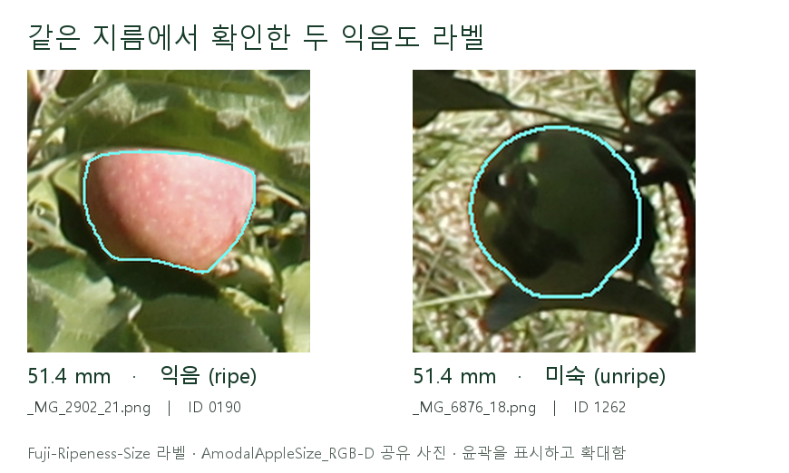

# 정해린 주간 작업 계획 및 수행 기록

**Team.D_24 사과 수확 로봇 비전 프로젝트 · 2026년 11월 16일~22일 · 11월 16일 실행 기준**

발표자료 14쪽에서 이번 주 내 담당은 **익음도·무게 라벨과 데이터 형식을 확인하는 일**이다. 실제 파일에서 사진과 정답을 연결했고, 가림 자료와의 중복도 확인했다. 다음 주 방법 검토에 쓸 비교값을 얻기 위해 작은 실험을 먼저 실행했다.

## 이번 주 완료 체크

- [x] **익음도** — Fuji-Ripeness-Size의 RGB 사진 4,027장과 VIA JSON을 대조했다. 익음·미숙 판정이 붙은 영역 18,462건과 빈 이미지 기록 36건을 확인했다.
- [x] **무게** — IntegrALIMENTA 후지 사과 60개의 JPG 4,320장을 검사했다. 파일명 속 무게와 폴더명이 전부 일치했고, 사과 하나당 72개 촬영 조건이 한 번씩 있었다.
- [x] **가림** — AmodalAppleSize 후지 사진 3,925장에서 사과가 보이는 부분과 추정 전체 윤곽 15,335쌍을 사진명·사과 ID로 연결했다.
- [x] **평가 자료 분리** — 익음도 예비 실험은 같은 원본 프레임과 사과 ID가 학습·검증·평가에 겹치지 않게 나눴다. 무게는 한 사과의 반복 사진 72장을 같은 분할에 배정했다.
- [x] **재현 자료** — 사진별 예측, 오분류, 무게 오차, 가림 면적, 예시 이미지와 실행 코드를 저장했다.
- [ ] **팀 합의** — 종호의 검출 결과에서 개별 사과 마스크를 어떤 파일·좌표 형식으로 전달할지 함께 확인한다. 아래에 현재 저장소 형식을 반영한 제안을 적었다.

## 교수님 질문에 답할 수 있는 사례

**지름이 51.4 mm로 같은 사과 두 개가 서로 다른 익음도 라벨을 받았다.** ID `0190`은 익음, ID `1262`는 미숙이다. 따라서 작은 사과도 원래 익음도 라벨대로 평가한다. 연구진이 색과 촬영 시점을 근거로 부여한 라벨이므로, 이 실험이 검증하는 대상은 사진에서 그 판정을 얼마나 재현하는가이다. [원 논문](https://arxiv.org/abs/2502.01850)

## 예비 실험에서 확인한 결과

| 내 담당 | 무엇으로 평가했나 | 이번 결과 |
|---|---|---|
| 익음도 | 정답 박스 중심부의 빨강·초록 색 차이로 분류. 학습에 없던 사과 ID 115개의 영역 202건 | 익음 20건 중 17건을 찾았다. 미숙 182건 중 30건을 익음으로 잘못 표시했다. 전체 정확도 83.7%, 두 클래스 재현율의 평균 84.3%. |
| 무게 | 실내·같은 촬영 조건에서 원본 화면 중 사과 색 영역이 차지하는 면적으로 무게를 회귀. 학습 48개, 평가 12개 | 이미지 정보만 쓴 평균 절대 오차(MAE)는 **36.52 g**. 매번 학습 사과의 평균 무게를 답하면 **46.77 g**이었다. |
| 합성 잎 가림 | 같은 평가 사진에서 원래 보이는 사과 면적의 0·15·30·50%를 덮어 다시 예측 | 추가 가림 30%에서 색 분류기가 익은 사과 20건을 모두 놓쳤다. 추가 가림 50%에서 이미지 기반 무게 오차는 **48.66 g**이었다. |

**무게 결과는 카메라 교란을 확인했다.** 위 무게 실험의 촬영 조건에서는 무게 묶음 세 개가 각각 다른 카메라로 찍혔다. 사진에서 카메라만 알아내도 오차가 10.3 g까지 내려간다. 사과를 지운 사진으로도 ResNet18이 15.2 g을 냈다. 사과 60개를 모두 iPhone 8로 찍은 54개 조건에서 다시 평가한 결과와 발표용 수치는 [무게 검증](무게검증/README.md)에 있다.

**지름은 발표자료 9쪽 식으로 추정했다.** 11월 23일에 사진 경계 판정 오류(100 px로 가정, 실제 137 px)를 고치고 다시 계산했다.
- 사과 단위 5겹 교차검증에서 전체 주석 15,335건의 23%에 값을 냈고, 보정 후 오차는 4.45 mm, 편향은 −0.98 mm다.
- 보이는 영역의 긴 변을 쓰면 자연 가림 15% 미만에서 2.7 mm, 50% 이상에서 13.9 mm다.
- 사진 경계에서 잘리거나, 깊이가 비거나, 보이는 면적이 긴 변 원의 75%에 못 미치면 판단을 보류한다.

자세한 내용은 [지름 추정](지름추정/README.md)에 있다.

**무게는 지름에서 추정한다.** 실험실 사진의 1유로 동전으로 사과 지름을 mm로 재고, 원근을 보정해 `무게 = 0.0037 × 지름^2.52`를 맞췄다.
- 실측 무게가 있는 60개에서 교차검증 오차는 14.2 g(6.6%)다.
- 무게 묶음 하나를 통째로 빼고 학습하면 가벼운 24.3 g, 중간 11.6 g, 무거운 22.6 g이다. 같은 묶음 안 순서는 가벼운 묶음만 유의했다.
- 과수원 사과에는 실측 무게가 없다. 지름 오차만으로 생기는 편향은 보정 전 −20 g, 보정 후 −5 g이다.

자세한 내용은 [무게 추정](무게추정/README.md)에 있다.

**익음도 모델을 보강했지만, 학습 없는 색 기준보다 낫다는 근거는 없다.**
- 가림 없는 평가 AP는 빨간 픽셀 비율 0.72(박스 입력 0.68), 신경망 0.66~0.69다. 합성 잎 50%에서는 0.67(박스 0.65), 미세조정 0.64다.
- 같은 사진의 겹친 조각에서 익음이 포함된 510묶음 중 207묶음(41%)의 라벨이 달랐다. 잘린 조각을 빼면 54묶음 중 7묶음(13%)이다.

자세한 내용은 [익음도 보강](익음도보강/README.md)에 있다.

**11월 21일 추가 작업 (수치는 23일 정정).**
- 지름 편향 보정은 × 1.042다. 교차검증 편향이 −3.49 → −0.98 mm가 됐다.
- 사진 20장 이상인 사과 62개에서 1장 → 10장을 평균하면 "다수 사진이 익음"인 사과 찾기 AP가 0.63 → 0.86, 판정 일치율이 0.68 → 0.87이 됐다.
- 조명을 바꿔도 AP는 최대 0.04만 내려갔다. 다만 판정은 5~16% 바뀌었다.
- YOLO 검출 결과를 받아 정답과 비교하는 도구와 55초 시연 영상을 만들었다.
- 별도 환경(`.venv-yolo`)에서 COCO 사전학습 YOLOv8x-seg로 임시 연결했다. 데모 사진 5장의 데이터셋 윤곽 36개 중 29개(81%)를 찾았고, 마스크 IoU는 0.80이었다. 검출을 포함한 처리 시간은 장당 약 0.28 s였다. 종호의 `best.pt`가 오면 같은 명령으로 다시 실행한다.

자세한 내용은 각 폴더 README에 있다.

**통합 데모를 만들었다.** 사진 한 장을 넣으면 사과마다 익음도(익음/미숙/보류), 지름과 예상 무게(±오차 범위, 신뢰도)를 사진 위에 표시한다. 11월 23일부터 화면 안의 사과는 잎에 가려 있어도 모양 특징 모델로 지름을 낸다(사과 단위 교차검증 5.0 mm, [지름 추정](지름추정/README.md)). 사진 경계에서 잘렸거나 깊이가 부족한 사과는 '참고' 추정(±16~19 mm)으로 따로 표시하고, 영상에서는 온전한 프레임의 값이 우선이다. 익음도는 11월 23일 검증 자료로 다시 고른 색 특징 모델을 쓴다([익음도 보강](익음도보강/README.md#기준-모델-다시-고르기-11월-23일)). 잘리지 않은 평가 사진에서 익음 판정의 1.3%가 한 번도 익음 라벨이 없는 사과였고, 조명에는 약하다. 종호와 맞출 JSON 형식 초안은 [통합 데모](통합데모/README.md)에 있다. 첫 장을 빼면 약 0.03 s/장(검출 제외)이었다.

첫 예비 실험의 익음도 평가에는 미숙이 182/202건이라 전부 미숙이라고 해도 정확도는 90.1%다. 수확 판단에는 **익은 사과를 얼마나 찾았는지**와 **미숙을 몇 개 잘못 골랐는지**를 함께 제시한다. 첫 예비 실험의 무게 수치(36.52 g, 14.26 g 등)는 카메라 교란 때문에 성능으로 쓰지 않는다. 현재 수치는 [무게 추정](무게추정/README.md)을 따른다.

## 종호와 맞출 입력·출력

| 방향 | 합의할 항목 | 팀 저장소에 맞춘 제안 |
|---|---|---|
| 검출·분할 → 내 분석 | 원본 RGB 이미지, 해당 프레임의 객체 ID, 박스, 가시 마스크 | 현재 검수 CSV의 `id, xmin, ymin, xmax_inclusive, ymax_inclusive`를 사용한다. Pillow로 자를 때 오른쪽·아래쪽 끝에 1을 더한다. 마스크는 RGB와 같은 높이·너비로 받고 이미지 키와 객체 ID를 함께 저장한다. |
| 내 분석 → 결과 화면 | 익음도, 예상 무게(g), 가림률, 판단 보류 사유 | 가시 마스크만 받은 현장 프레임은 자연 가림률의 분모인 전체 윤곽이 없으므로 값을 비워 둔다. 무게에는 촬영 조건과 보정 유무를 함께 기록한다. |

## 진행 순서와 남은 일

| 시점 | 진행 상태 | 확인할 결과 |
|---|---|---|
| 11월 16일 | 로컬 검수·예비 실험 완료 | 사진–라벨 대응, 데이터 중복, 실제 오차와 실패 사례를 파일로 저장했다. |
| 11월 17~23일 | 방법 검토·재검증 완료, 팀 확인 대기 | [보고서·발표자료](../2026-11-23)를 만들었다. 입력·출력 형식은 초안이며 종호와 합의하기 전이다. |
| 11월 24~30일 | 다음 작업 | 종호의 best.pt로 통합 평가, 익음도 기준 모델 결정, YOLO 윤곽용 지름 보정. |
| 12월 1~6일 | 발표자료상의 가림·움직임 실험 | 합성 잎 예비 실험은 완료했다. 실제 영상과 추적을 포함한 평가가 남았다. |

세부 수치, 데이터 출처, 실행 명령과 결과 파일은 [실험 기록](실험기록.md)에 정리했다.
