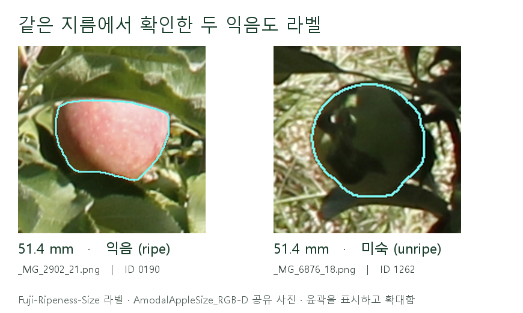
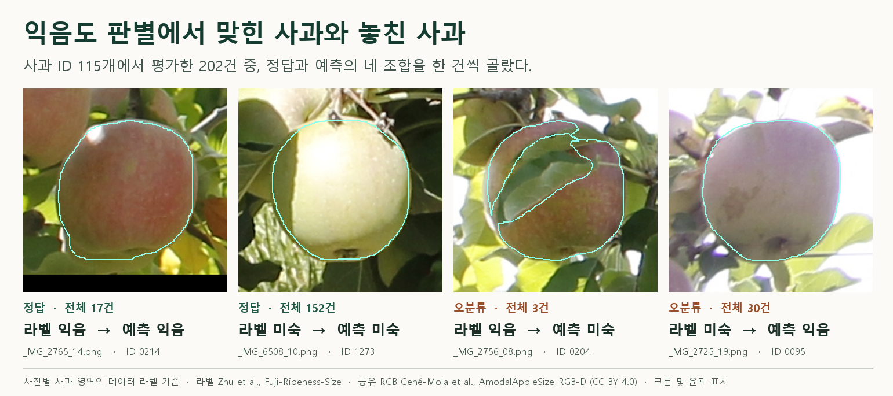
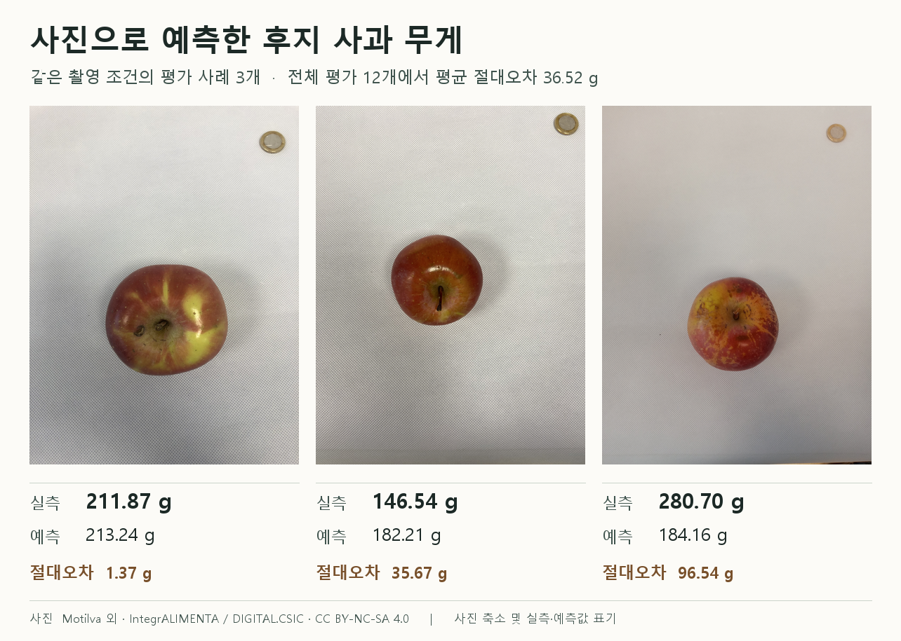
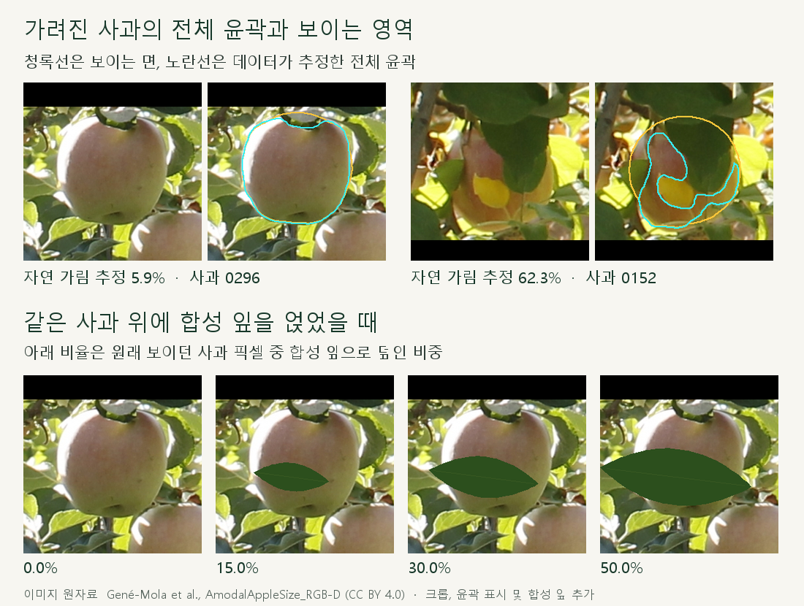
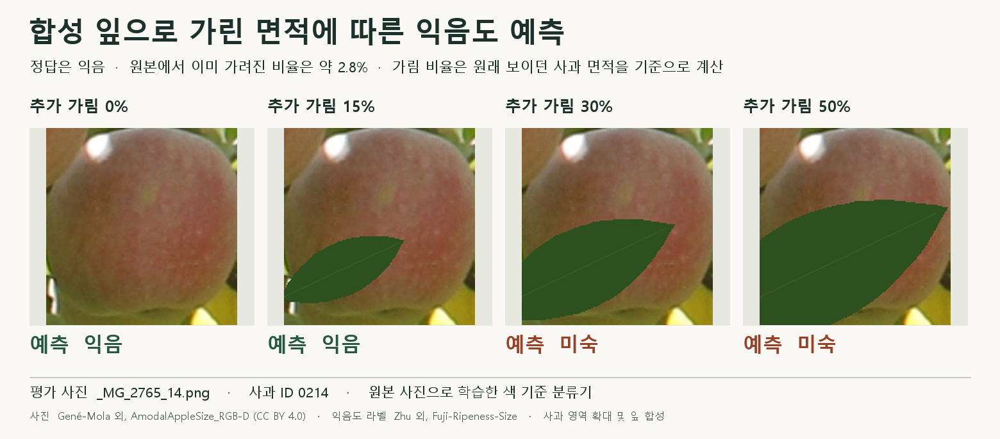
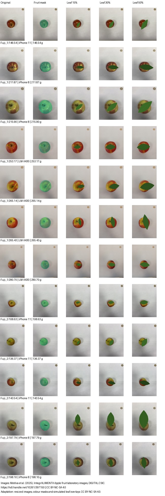

# 정해린 · 사과 익음도·무게·가림 실험 사진

Team.D_24 사과 수확 로봇 비전 프로젝트 · 2026년 11월 16일 예비 실험

> **정정(11월 23일).** 이 사진들은 11월 16일 예비 실험의 사례다. 3·6번의 무게 수치는 카메라 교란 때문에 성능으로 쓰지 않는다. 사과 0190은 미세조정 모델의 학습 사과라 `크기와익음도_사례`에 적힌 예측은 평가 결과가 아니다.

## 1. 같은 지름에서 확인한 두 익음도 라벨

두 과실의 실측 지름은 모두 **51.4 mm**다. 연구진은 왼쪽 사과(ID 0190)에 익음, 오른쪽 사과(ID 1262)에 미숙 라벨을 붙였다. 청록색 선은 사진에서 보이는 사과의 윤곽이다.

## 2. 익음도 모델이 맞힌 사과와 틀린 사과

평가 사진에서 익음·미숙을 각각 맞힌 경우와, 미숙을 익음으로 또는 익음을 미숙으로 판단한 경우를 골랐다. 전체 평가에서 색 기반 모델이 익음으로 고른 47건 중 17건이 실제 익음 라벨이었다.

## 3. 실제 무게와 사진으로 예측한 무게

실측 **211.87 g**인 사과는 **213.24 g**으로 예측했고, **280.70 g**인 사과는 **184.16 g**으로 예측했다. 사진 세 장은 오차가 과실마다 얼마나 달랐는지 보여 준다. 이미지에 나타난 면적만 사용한 모델의 평가 사과 12개 평균 절대오차는 **36.52 g**이었다.

## 4. 과수원의 자연 가림과 합성 잎

위쪽 사진에서 청록색은 보이는 면, 노란색은 추정한 전체 윤곽이다. 두 사과의 자연 가림률은 각각 **5.9%**, **62.3%**다. 아래쪽은 같은 사진에서 원래 보이던 사과 면적에 합성 잎을 추가한 네 조건이다.

## 5. 같은 사과를 더 가렸을 때의 익음도 예측

동일한 평가 사진에서 합성 잎이 원래 보이는 사과 면적의 **0%, 15%, 30%, 50%**를 덮도록 했다. 각 사진 아래에 색 기반 모델의 예측을 표시했다. 전체 평가에서 익음 라벨 20건 중 모델이 찾은 수는 차례로 **17건, 8건, 0건, 0건**이었다. 0%는 원본에 잎을 추가하기 전이다.

## 6. 무게 평가에 쓴 사과 12개 전체

한 줄이 같은 과실이다. 왼쪽부터 원본, 색으로 추정한 사과 영역, 추가 가림 15%, 30%, 50%다. 원본 사진으로 학습한 이미지 기반 모델의 평균 절대오차는 추가 가림 0%에서 **36.52 g**, 50%에서 **48.66 g**이었다.

### 사진·라벨 출처

- **과수원 사진과 윤곽** — Gené-Mola 등, AmodalAppleSize_RGB-D, CC BY 4.0. 공유 RGB 사진을 잘라 확대하고 윤곽, 합성 잎 또는 결과 표기를 추가했다. 익음도 라벨은 Zhu 등의 Fuji-Ripeness-Size를 사용했다. [RGB·윤곽 데이터](https://doi.org/10.34810/data916) · [CC BY 4.0](https://creativecommons.org/licenses/by/4.0/) · [익음도 라벨 배포본](https://www.kaggle.com/datasets/zhukeyi1/fuji-ripeness-and-size-dataset)
- **실험실 무게 사진** — Motilva 등, IntegrALIMENTA Apple fruit laboratory images, DIGITAL.CSIC. 원본을 축소하고 예측값, 마스크 또는 합성 잎을 표시한 3번·6번 사진 자료에는 CC BY-NC-SA 4.0을 적용한다. [데이터와 배포 조건](https://datos.gob.es/en/catalogo/ea0041268-integralimenta-apple-fruit-laboratory-images-dataset) · [CC BY-NC-SA 4.0](https://creativecommons.org/licenses/by-nc-sa/4.0/)
