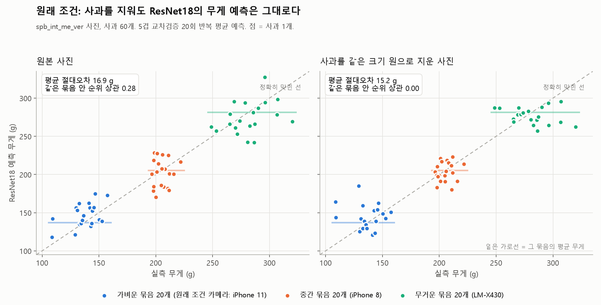
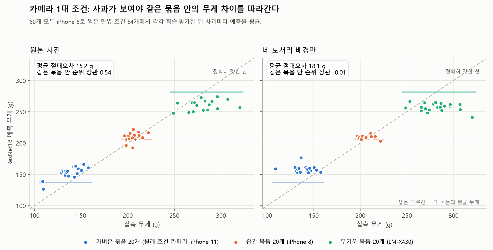
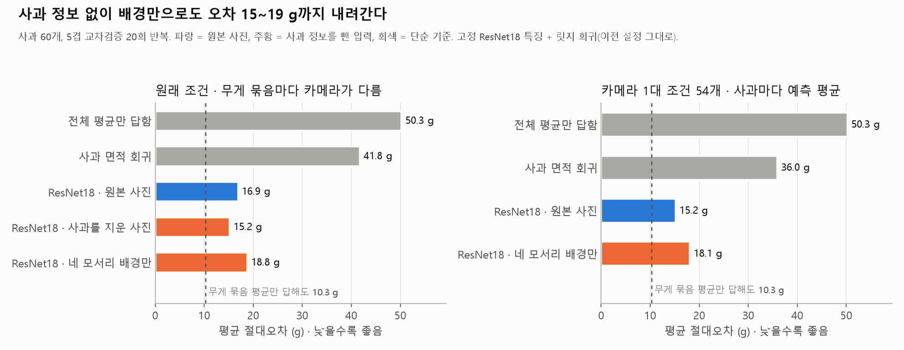
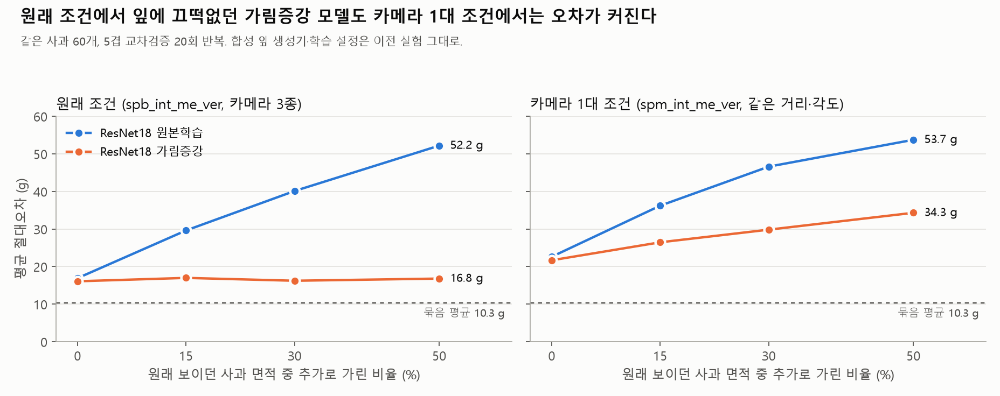

# 정해린 · 무게 추정 결과의 카메라 교란 검증

2026년 11월 16일 실행 · [전이학습 무게 결과](../전이학습/README.md#무게-결과)의 14.26 g이 사과를 보고 맞힌 값인지 확인했다.

## 결론

**이전 실험 조건에서 ResNet18의 무게 예측은 사과가 아니라 배경과 카메라 정보로 설명된다.** 사과를 같은 크기의 회색 원으로 지운 사진에서도 오차는 15.2 g이었다. 원본 사진의 오차는 16.9 g이었다. 지운 사진의 특징만으로도 어느 카메라로 찍었는지를 100% 맞혔다. 카메라별 평균 무게만 답하면 오차가 10.3 g으로 ResNet18보다 작았다.

**이 자료에서 단순한 g 오차는 사과를 읽는 능력을 보여 주지 못한다.** 사과 60개는 무게 범위가 겹치지 않는 20개씩 세 묶음으로 나뉜다. 사진에서 묶음만 알아내도 오차가 10~19 g까지 내려간다. 카메라가 1대인 조건에서도 네 모서리 배경만으로 같은 수준의 오차가 나왔다.

**사과 자체의 정보는 같은 묶음 안의 순위로 확인했다.** 카메라 1대 조건 54개의 예측을 사과마다 평균하면 같은 묶음 안 순위 상관이 0.54였다. 배경만 쓴 입력은 −0.01이었다. 사진에서 사과 크기 정보를 일부 읽고 있지만 묶음 평균(10.3 g)보다 정확하지는 않다.

**발표에서는 "ResNet18로 36.52 g → 14.26 g"을 성능 향상으로 쓰지 않는다.** 아래 결과를 대신 쓴다.



## 왜 교란이 생겼나

무게 자료의 72개 촬영 조건 중 54개는 사과 60개 모두 **iPhone 8 한 대**로 찍었다. 이전 실험이 고른 `spb_int_me_ver`는 남은 18개 조건 중 하나다. 이 조건에서는 무게 묶음마다 카메라가 다르다. [촬영 조건별 카메라 수](results/camera_by_view.csv)

| 무게 묶음 (각 20개) | 실측 무게 범위 | 표준편차 | `spb_int_me_ver`의 카메라 |
|---|---:|---:|---|
| 가벼운 묶음 | 108.6~157.4 g | 12.5 g | iPhone 11 |
| 중간 묶음 | 196.4~221.8 g | 6.9 g | iPhone 8 |
| 무거운 묶음 | 248.7~320.1 g | 18.1 g | LM-X430 |

카메라마다 화각과 배율이 다르다. 그래서 이 조건에서는 무거운 묶음의 사과가 중간 묶음보다 사진에서 작게 찍혔다. 카메라를 무시한 사과 면적 회귀가 약했던 이유다. 반대로 배경의 색·밝기·동전 크기만 보아도 카메라를 알 수 있고, 카메라를 알면 무게 묶음을 안다. 카메라 1대 조건 중 확인한 4개에서는 세 묶음이 같은 날 촬영됐다.

## 평가 방법

- 사과 60개 전체를 **5겹 교차검증, 20회 반복**으로 평가했다. 매 겹마다 각 묶음에서 4개씩, 총 12개를 평가에 둔다. 이전의 48/12 분할과 같은 비율이다.
- 특징 추출, 색 마스크, 합성 잎, 릿지 회귀(λ 0.1)는 **이전 실험 코드를 그대로 불러 썼다.** 이전 48/12 고정 분할에 다시 적용하면 평균·면적 기준의 46.77 g, 36.52 g, 12.92 g, 12.46 g이 똑같이 나온다. ResNet18의 14.26 g과 가림 50% 증강 18.48 g은 GPU 배치 차이로 0.05 g 이내에서 재현됐다.
- **사과를 지운 사진**은 색 마스크의 가장 큰 덩어리를 덮는 회색 원을 그린 사진이다. 원 크기는 모든 사진에서 같아서 원 크기로 사과 크기가 새지 않는다. 60장 모두 사과가 완전히 가려진 것을 눈으로 확인했다.
- **네 모서리 배경만**은 화면 네 귀퉁이(가로·세로 22%)만 이어 붙인 입력이다. 마스크 없이 모든 촬영 조건에 쓸 수 있다.
- **같은 묶음 안 순위 상관**은 20개짜리 묶음 안에서 실측 무게 순서와 예측 순서의 스피어만 상관을 구해 세 묶음을 평균한 값이다. 묶음 정보만 쓴 모델은 0 근처가 된다. 평균만 답하는 기준선은 교차검증 특성상 음수가 나오므로 표에서 뺐다.
- 두 방법의 차이는 사과 단위 부트스트랩(묶음별 층화, 4,000회)으로 95% 구간을 냈다.

## 결과 1 · 원래 조건 `spb_int_me_ver`

| 방법 | 평균 절대오차 | 반복 20회 범위 | 같은 묶음 안 순위 상관 |
|---|---:|---:|---:|
| 전체 평균만 답함 | 50.3 g | 50.1~50.5 | — |
| 사과 면적 회귀 (카메라 무시) | 41.8 g | 41.3~42.8 | 0.12 |
| **카메라별 평균만 답함** | **10.3 g** | 9.9~10.9 | — |
| 카메라별 사과 면적 회귀 | 10.7 g | 9.8~11.2 | −0.51 |
| ResNet18 · 원본 사진 | 16.9 g | 15.7~17.9 | 0.28 |
| ResNet18 · 사과를 지운 사진 | **15.2 g** | 13.5~16.6 | 0.00 |
| ResNet18 · 네 모서리 배경만 | 18.8 g | 16.7~20.4 | −0.02 |

- ResNet18 특징으로 카메라 기종을 분류하면 원본 사진 96.1%, 사과를 지운 사진 100%, 네 모서리 100%를 맞혔다.
- ResNet18 원본에서 카메라별 평균을 빼면 오차 차이가 **+6.6 g**(95% 구간 3.5~10.0 g)이다. 카메라별 평균이 더 정확하다.
- 사과를 지운 사진에서 원본 사진을 빼면 **−1.7 g**(95% 구간 −5.5~2.2 g)이다. 사과가 보여서 좋아졌다는 근거가 없다.

## 결과 2 · 카메라 1대 조건 54개

같은 사과 60개를 촬영 조건마다 따로 학습·평가했다. [조건별 결과](results/single_camera_views.csv)

| 방법 | 조건별 오차 중앙값 (범위) | 실내 18개 중앙값 | 실외 36개 중앙값 | 54개 조건 예측을 평균했을 때 | 평균했을 때 같은 묶음 안 순위 상관 |
|---|---:|---:|---:|---:|---:|
| 전체 평균만 답함 | 50.3 g | 50.3 g | 50.3 g | 50.3 g | — |
| 사과 면적 회귀 | 42.8 g (20.3~54.1) | 42.5 g | 42.8 g | 36.0 g | 0.52 |
| ResNet18 · 원본 사진 | 23.2 g (15.0~42.5) | 23.7 g | 22.5 g | **15.2 g** | **0.54** |
| ResNet18 · 네 모서리 배경만 | 28.0 g (17.5~47.6) | 34.5 g | 24.7 g | 18.1 g | −0.01 |

- 원래 조건과 장소·거리·각도가 같고 받침만 다른 `spm_int_me_ver`에서는 ResNet18 원본 22.6 g, 네 모서리 37.1 g, 사과 면적 25.1 g이었다.
- 실외 조건에서는 배경만으로도 원본과 비슷한 오차가 나온다. 묶음 순서대로 찍으며 햇빛이나 위치가 바뀌었을 가능성이 있지만 확인하지 않았다.
- 54개 조건 평균에서 원본은 배경보다 오차가 2.9 g 작다(95% 구간 0.8~5.2 g). 순위 상관은 원본만 가벼운 0.62, 중간 0.52, 무거운 0.47로 세 묶음 모두 양수였다.





## 결과 3 · 합성 잎 가림 다시 보기

이전 표의 가림증강 결과(50% 가림에서 18.48 g)를 같은 교차검증으로 다시 계산했다. [조건별 수치](results/leaf_occlusion.csv)

| 추가 가림 | 원래 조건 · 원본학습 | 원래 조건 · 가림증강 | 카메라 1대 · 원본학습 | 카메라 1대 · 가림증강 |
|---|---:|---:|---:|---:|
| 0% | 16.9 g | 16.1 g | 22.6 g | 21.7 g |
| 15% | 29.6 g | 17.0 g | 36.2 g | 26.4 g |
| 30% | 40.1 g | 16.2 g | 46.6 g | 29.8 g |
| 50% | 52.2 g | 16.8 g | 53.7 g | 34.3 g |

원래 조건에서 가림증강 모델은 잎을 덮어도 오차가 그대로였다. 사과를 지워도 맞히는 모델이므로 잎에 둔감한 것은 당연하다. 카메라 1대 조건에서는 증강해도 50% 가림에서 오차가 1.6배로 커졌다. 증강은 원본학습보다 여전히 낫다.



## 발표·후속 작업에 반영할 것

- 무게 결과는 **카메라 1대 조건**의 수치와 **같은 묶음 안 순위 상관**을 함께 보고한다. 묶음 평균만 답한 10.3 g도 기준선으로 같이 둔다.
- 사진 속 1유로 동전(지름 23.25 mm)으로 픽셀을 mm로 바꾸면 촬영 거리와 카메라에 덜 의존하는 크기 특징을 만들 수 있다. 지름 기반 무게 추정(발표자료 10쪽 ③)과도 이어진다.
- 무게 묶음과 촬영 순서가 겹쳐 있는 한, 이 자료만으로는 처음 보는 카메라나 과수원에서의 g 오차를 주장할 수 없다.

## 실행

이 폴더를 PowerShell에서 연다. 이전 전이학습 환경에 SciPy만 추가로 쓴다(사과 마스크의 덩어리 구분). 실행 환경은 Python 3.11.9, PyTorch 2.12.0+cu130, TorchVision 0.27.0, NumPy 2.4.6, SciPy 1.17.1, Pillow 12.3.0, Matplotlib 3.11.1이다.

```powershell
$pythonPath = 'C:\Users\sclov\PycharmProjects\Graduation-project\.venv\Scripts\python.exe'
& $pythonPath validate_weight.py --data-root 'D:\Apple-harvest-data\weight' --weights '..\전이학습\weights\resnet18-f37072fd.pth' --device cuda
& $pythonPath make_figures.py
```

처음 실행하면 사진 약 3,400장을 인코딩해 `cache/`(약 30 MiB)에 저장한다. 캐시는 사진 목록과 변형 설정이 같을 때만 다시 쓴다. GPU 배치 구성이 다르면 같은 사진의 특징이 최대 0.002 정도 달라질 수 있다.

- `validate_weight.py` — 세 가지 검증과 결과 저장, `make_figures.py` — 그림 4장
- `results/metrics.json` — 모든 수치와 설정, `results/apple_predictions.csv` — 사과별 반복 평균 예측
- `results/single_camera_views.csv` — 54개 조건 × 4개 방법, `results/leaf_occlusion.csv` — 가림 비교
- `results/camera_by_view.csv` — 72개 촬영 조건별 EXIF 카메라 수

자료: Motilva 등, IntegrALIMENTA Apple fruit laboratory images, DIGITAL.CSIC, CC BY-NC-SA 4.0. 그림은 수치만 표시하며 원본 사진을 포함하지 않는다. [데이터와 배포 조건](https://datos.gob.es/en/catalogo/ea0041268-integralimenta-apple-fruit-laboratory-images-dataset) · [ResNet18 가중치](https://docs.pytorch.org/vision/stable/models/generated/torchvision.models.resnet18.html)
