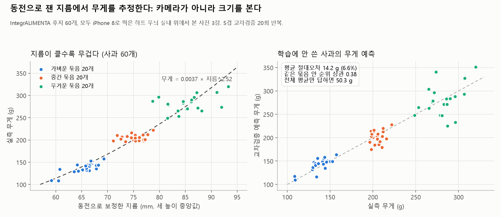

# 정해린 · 지름에서 무게 추정 (발표자료 10쪽 ③)

2026년 11월 17일 실행 · 사진에서 바로 무게를 맞히는 방식은 [무게 검증](../무게검증/README.md)에서 카메라를 읽는 것으로 드러났다. 그래서 사과의 실제 지름(mm)을 재고 지름에서 무게를 구하는 방식으로 바꿨다.

## 결론

- **실측 무게가 있는 사과 60개에서 교차검증 평균 절대오차 14.2 g(6.6%)였다.** 전체 평균만 답하면 50.3 g이다.
- **이번에는 사과 크기를 보고 맞힌다.** 같은 무게 묶음 안에서도 지름 순서가 무게 순서와 맞았다. 순위 상관은 가벼운 0.71, 중간 0.18, 무거운 0.25로 세 묶음 모두 양수였다. 이전 이미지 회귀는 사과를 지워도 오차가 같았다.
- 묶음 평균만 답하는 참고값(10.3 g)보다는 3.9 g 크다. 다만 95% 구간이 −0.3~8.2 g이라 의미 있는 차이라고 보기는 어렵다. 묶음 평균은 실제로는 알 수 없는 정보다.
- **사과 60개 전체로 맞춘 식은 `무게(g) = 0.0037 × 지름(mm)^2.52`다.** [통합 데모](../통합데모/README.md)가 이 식을 쓴다.
- **과수원에 적용하면 오차가 더 커진다.** RGB-D 지름 추정의 편향(평균 −4.8 mm) 때문에 무게가 평균 23 g 작게 나온다. 지름 오차로 생기는 무게 차이는 평균 31 g, 중앙값 14 g이다. 과수원 사과는 무게를 잰 적이 없어서 최종 오차를 직접 잴 수는 없다.



## 지름 재는 방법

1. **사진 고르기** — 60개 모두 iPhone 8로 찍은 위에서 본(ver) 조건 18개를 측정했다. 이 중 하트 무늬 실내 조건 3개(높이 al·me·ce)만 썼다. 접시 조건(`pgb`)은 접시 무늬를 동전으로 잘못 찾아 전부 실패했다. 흰 바탕 실외 조건은 그림자 때문에 실패가 많았다. 고를 때 무게는 보지 않았다.
2. **사과 윤곽** — 이전 실험의 따뜻한 과피색 마스크에서 가장 큰 덩어리를 고르고 구멍을 메웠다. 면적을 같은 면적의 원 지름으로 바꿨다.
3. **동전** — 1유로 동전(지름 23.25 mm)을 Hough 원 검출로 찾았다. 사과 가까이의 원은 빼고, 테두리 경계가 가장 뚜렷한 원을 골랐다. 동전 지름 픽셀로 mm 단위를 정했다.
4. **원근 보정** — 동전은 탁자 위에 있고 사과의 가장 넓은 단면은 지름의 절반 높이에 있다. 그래서 가까이 찍을수록 사과가 크게 재진다. EXIF 35 mm 환산 초점거리(28 mm → 809 px)와 동전 크기로 카메라 높이 Z를 구했다. 그다음 `D = D_동전기준 / (1 + D_동전기준 / 2Z)`로 고쳤다.
   - 카메라 높이 중앙값은 al 261 mm, me 213 mm, ce 154 mm로, 자료 설명의 20~30 cm 근처다.
   - 같은 사과를 가장 가까이(ce)와 가장 멀리(al)에서 잰 지름 차이가 보정 전 **+11.3 mm**에서 보정 후 **−0.1 mm**가 됐다. 무게를 쓰지 않은 확인이다.
5. **실패 처리** — 55~130 mm를 벗어난 값은 동전 검출 실패로 보고 뺐다(al 2장, ce 4장). 사과마다 남은 높이들의 중앙값을 썼다.
6. `review/*.jpg`에서 18개 조건 사과 60개의 윤곽(청록)과 동전(빨강)을 모두 확인할 수 있다.

## 교차검증 결과

사과 60개를 5겹으로 나누고 20회 반복했다. 매 겹은 각 무게 묶음에서 4개씩 뺀다(무게 검증과 같은 분할). 식은 학습 겹으로만 맞췄다.

| 방법 | 평균 절대오차 | 반복 20회 범위 | 같은 묶음 안 순위 상관 |
|---|---:|---:|---:|
| 전체 평균만 답함 | 50.3 g | 50.1~50.5 | — |
| 지름^b 식, me 높이 한 장 | 16.3 g | 15.8~16.8 | 0.37 |
| **지름^b 식, 세 높이 중앙값** | **14.2 g (6.6%)** | 13.8~14.7 | **0.38** |
| 지름³ 식(밀도 × 모양 하나만 맞춤), 세 높이 | 17.0 g | 16.7~17.5 | 0.39 |
| 참고: 묶음 평균만 답함 | 10.3 g | 9.9~10.9 | — |

- 지름³ 식의 계수를 밀도 × 모양 계수로 바꾸면 0.88 g/cm³다. 사과 밀도로 무리 없는 값이다.
- 지름 범위는 59~93 mm다. 이 밖의 사과에 식을 쓰면 범위를 넘어선 추정이다. 데모는 이런 경우 무게 옆에 `*`를 붙인다.

## 과수원 지름 오차가 무게에 미치는 영향

[지름 추정](../지름추정/README.md)의 평가 사과 175개를 썼다. RGB-D로 추정한 지름과 캘리퍼 지름을 각각 위 식에 넣고 비교했다.

| | 값 |
|---|---:|
| 캘리퍼 지름으로 계산한 무게 중앙값 (범위) | 113 g (51~356 g) |
| 지름 추정 오차로 생기는 무게 차이 · 평균 / 중앙값 | 31 g / 14 g |
| 평균 편향 | −23 g (작게 추정) |
| 식을 맞춘 지름 범위 안의 사과 | 175개 중 87개 |

과수원 자료에는 성장 중인 작은 녹색 사과가 많다. 그래서 절반은 식을 맞춘 범위 밖이다. 과수원 무게의 최종 오차는 "실험실 식 오차 약 14 g + 지름 오차로 생기는 차이"로 봐야 한다. 지름 편향(−4.8 mm)을 학습+검증 자료로 보정하면 이 차이를 줄일 수 있다.

## 실행

```powershell
$pythonPath = 'C:\Users\sclov\PycharmProjects\Graduation-project\.venv\Scripts\python.exe'
& $pythonPath measure_size.py --views spm_int_al_ver spm_int_me_ver spm_int_ce_ver
& $pythonPath fit_weight.py
& $pythonPath make_figures.py
```

`fit_weight.py`는 [지름 추정](../지름추정/README.md)의 `results/per_apple_test.csv`도 읽는다. OpenCV 5.0.0을 추가로 쓴다.

- `results/size_measurements.csv` — 사진별 사과·동전 픽셀 크기, 초점거리, 동전 기준 지름
- `results/apple_diameters.csv` — 사과별 보정 지름(높이별, 중앙값), 실측 무게, 교차검증 예측
- `results/metrics.json` — 측정 점검, 교차검증, 최종 식, 과수원 전파 결과

자료: Motilva 등, IntegrALIMENTA Apple fruit laboratory images, DIGITAL.CSIC, CC BY-NC-SA 4.0. `review/` 사진은 원본을 축소하고 윤곽·동전 표시를 더한 것으로 CC BY-NC-SA 4.0을 따른다. [데이터와 배포 조건](https://datos.gob.es/en/catalogo/ea0041268-integralimenta-apple-fruit-laboratory-images-dataset)
