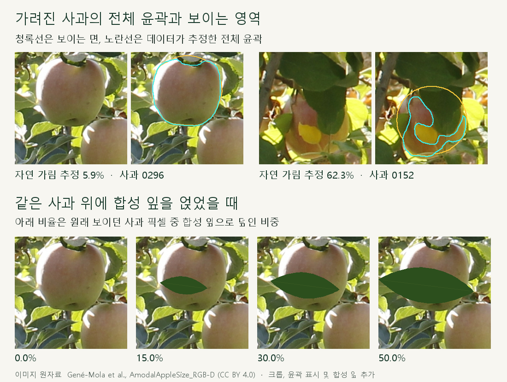

# 익음도·무게·가림 분석 실험 기록

정해린 담당 · 2026년 11월 16일 · 데이터 위치 `D:\Apple-harvest-data`

## 1. 익음도 라벨과 입력 형식

각 분할의 `images/<사진명>.png`에 `<분할>_via_final.json`의 `filename`을 연결하고, 객체별 `regions[i].region_attributes.Ripeness`를 읽었다. 값은 `ripe` 또는 `unripe`이다. 세 분할 모두 RGB·JSON의 사진명과 깊이 배열 `depths/*.npy`의 기본 파일명이 대응했다. PNG에는 1,300×1,300과 1,920×1,080 두 해상도가 있다. RGB가 이번 실험의 입력이다. [분할별 검수 JSON](ripeness/results/summary.json)

| 배포 분할 | 사진 | 익음 | 미숙 | 영역 합계 | 영역이 빈 사진 |
|---|---:|---:|---:|---:|---:|
| 학습 | 2,385 | 1,733 | 9,361 | 11,094 | 14 |
| 검증 | 824 | 456 | 3,289 | 3,745 | 13 |
| 평가 | 818 | 385 | 3,238 | 3,623 | 9 |
| 합계 | 4,027 | 2,574 | 15,888 | 18,462 | 36 |

로컬 VIA에는 다각형 15,300건, 사각형 3,162건이 있다. 사각형에는 정확한 가시 면적을 알 수 있는 픽셀 마스크가 없다. `Diameter=-1`인 2,240건은 지름 정답을 사용하는 평가에서 제외한다. 논문 초록은 주석 사과 16,257개를 보고한다. 이번 표는 로컬 JSON의 영역 행을 센 값이며, 두 집계가 다른 이유는 확인되지 않았다. [저자 논문](https://arxiv.org/abs/2502.01850) · [저자 배포 안내](https://github.com/zhukeyi-stan/Fuji_Ripeness_And_Size_Estimation)

**중복 확인.** 익음도 ZIP과 AmodalAppleSize ZIP의 RGB 3,925장이 파일명·바이트 수·ZIP CRC32까지 일치했다. 분할별 1장씩은 SHA-256도 일치했다. 같은 사진 안에서 가시 윤곽의 모든 좌표가 유일하게 일치하는 영역 15,271건에 사과 ID를 연결했다. 기준을 통과하지 못한 익음도 다각형 29건과 가림 쪽 영역 64건은 연결에서 제외했다. 같은 ID 표기 291개가 원 배포의 학습과 평가에 함께 있었다. 연결된 ID 594개 중 139개에는 두 익음도 라벨이 모두 관찰되어 사진별 라벨을 보존했다. [중복 검사](integration/results/overlap.json) · [객체 연결표](integration/results/linked_instances.csv) · [라벨 사례](integration/results/case_checks.json)

**색 기준 실험.** 원본 프레임의 다른 크롭과 같은 사과 ID가 분할을 넘지 않게 한 뒤 정답 박스 중심부의 평균 `(R−G)/(R+G+1)`을 계산했다. 임계값 0.04857은 학습 자료에서 두 클래스의 재현율 평균을 최대화해 골랐다. 학습 895영역(271 ID), 검증 338영역(134 ID), 평가 202영역(115 ID)이다. 평가 정답/예측은 익음→익음 17, 익음→미숙 3, 미숙→익음 30, 미숙→미숙 152였다. 익음으로 고른 47건 중 실제 익음 라벨은 17건(36.2%)이었다. 정답 위치를 사용했으므로 검출기를 연결했을 때의 누락까지 측정하려면 별도 평가가 필요하다. [분할·성능 요약](ripeness/results/linked_summary.json) · [객체별 예측](ripeness/results/linked_predictions.csv)

## 2. 실측 무게와 촬영 조건

후지 자료 `Fuji_1`과 `Fuji_2`의 과실 폴더 60개에 각각 72장씩 있다. 예를 들어 `Fuji_1/146.54/Rio_M_Fuji_146,54_Spb_int_me_ver.JPG`는 폴더와 파일명이 모두 **146.54 g**을 가리킨다. 전체 범위는 **108.63~320.09 g**이다. 환경 2종 × 받침 4종 × 거리 3종 × 각도 3종이 과실마다 한 번씩 있다. 각 과실의 반복 사진은 같은 분할에 두었다. [사진–무게 대응표](weight/results/weight_manifest.csv) · [배포기관 자료](https://digital.csic.es/handle/10261/397150)

JPG 4,320장을 모두 축소 해상도로 디코딩했다. 축소 픽셀 배열이 동일한 사진은 0장이었다. 실험에는 과실마다 같은 촬영 조건 코드의 한 장을 썼다. 실내·기본 바닥·중간 거리·위에서 본 구도다. 중간 거리는 20~30 cm 범위다. 원본 화면 비율을 유지해 과피 색 영역의 면적 비중을 구하고, 면적 비중의 1.5제곱으로 무게를 선형 회귀했다. 무게 정답과 파일명은 입력 특징에서 제외했다. 카메라마다 서로 다른 사과 16개를 학습하고 4개를 평가해 총 48개/12개로 나눴다. [JPG 검수 결과](weight/results/weight_image_audit.json) · [색 마스크·합성 예시](weight/results/weight_mask_review.jpg)

| 가림을 추가하지 않은 조건 · 평가 과실 12개 | MAE |
|---|---:|
| 학습 과실의 평균 무게 | 46.77 g |
| RGB 면적만 사용 | **36.52 g** |
| EXIF 카메라별 학습 무게 평균 | 12.92 g |
| EXIF 카메라별 RGB 면적 회귀 | 12.46 g |

세 카메라가 촬영한 과실의 무게 범위가 이번 자료에서는 서로 겹치지 않았다. 카메라 종류만으로도 오차가 크게 줄어든다. 당시에는 **36.52 g**을 기준으로 비교했다. **정정:** 이후 [무게 검증](무게검증/README.md)에서 카메라·배경 교란이 확인돼 이 절과 아래 표의 무게 수치는 성능으로 쓰지 않는다. 현재 수치는 [무게 추정](무게추정/README.md)을 따른다. 과수원 적용 전에는 거리나 기준 물체로 크기를 보정하고 새로운 카메라에서도 검증해야 한다. [모델·카메라별 수치](weight/results/weight_metrics.json) · [개별 예측](weight/results/weight_predictions.csv)

## 3. 자연 가림과 합성 잎 실험

**자연 가림**은 보이지 않는 과실의 추정 비율이다. 가시 마스크 V는 실제 보이는 부분의 주석이고, 전체 마스크 A는 실측 지름에 맞춘 3차원 구를 사진에 투영해 추정한 윤곽이다. `1 − 면적(V)/면적(A)`를 그대로 적용하면 두 윤곽의 어긋남으로 69건에서 음수가 나왔다. 이번 검수에서는 `1 − 면적(V ∩ A)/면적(A)`를 사용했다. 사진 경계(137~1160 px) 밖으로 나간 5,881건을 제외(11월 23일 정정, 이전에는 경계를 100 px로 잘못 잡아 4,162건)하고, 가시 픽셀의 10%를 넘게 전체 윤곽 밖에 두는 사례도 제외하도록 했다(해당 0건). 남은 **9,454개 관측 영역**에서 자연 가림률의 중앙값은 **44.94%**였다. 같은 사과가 여러 시점에 보이므로 과실 9,454개라는 뜻은 아니다. [가림 검수표](occlusion/results/natural_occlusion.csv) · [원 논문](https://pmc.ncbi.nlm.nih.gov/articles/PMC10809076/)



**합성 가림**은 원래 보이던 과실 픽셀을 분모로 두고 잎 모양 도형이 추가로 덮은 비율이다. 0%에는 원본의 자연 가림이 그대로 들어 있다. 각각 같은 평가 과실에 네 조건을 적용했다. 익음도는 정답 가시 다각형, 무게는 실험실 영상에서 색으로 추정한 마스크를 사용했다. 증강 모델은 학습 과실에만 원본과 세 가지 합성 가림을 적용해 맞췄다.

| 추가로 가린 비율 | 익음을 찾은 건수 / 익음 20건 | 균형 정확도 원본학습 / 증강학습 | 이미지 기반 무게 MAE 원본학습 / 증강학습 |
|---|---:|---:|---:|
| 0% | 17 / 20 | 84.3% / 82.9% | 36.52 / 41.37 g |
| 15% | 8 / 20 | 69.2% / 68.6% | 39.15 / 39.40 g |
| 30% | 0 / 20 | 50.0% / 50.0% | 42.15 / 39.21 g |
| 50% | 0 / 20 | 50.0% / 50.0% | 48.66 / 42.78 g |

익음 검출 건수 열은 원본학습 모델 기준이다. 색 기준 모델은 녹색 합성 잎에 민감해 30%부터 평가 영역 전체를 미숙으로 분류했다. 무게 증강은 50% 조건의 MAE를 줄였지만, 같은 과실에서 원본 대비 예측이 바뀐 절대량의 평균은 32.98 g에서 34.40 g으로 커졌다. 실제 잎 모양·위치·움직임이 바뀔 때의 결과와, 판단을 보류할 가림 임계값은 후속 검증 대상이다. [익음도 가림 결과](occlusion/results/ripeness_stress_summary.json) · [무게 가림 결과](weight/results/weight_metrics.json)

## 4. 재현 방법과 출처

이 폴더에서 PowerShell로 실행한다. Python 3.11.9와 Pillow 12.3.0에서 실험했다. 첫 줄은 프로젝트 인터프리터에 Pillow가 필요할 때 실행한다. 결과는 지정한 폴더의 작업별 `results`에 저장된다.

```powershell
python -m pip install Pillow==12.3.0
python reproduce.py --data "D:\Apple-harvest-data" --out ".\재실행결과"
```

입력은 `ripeness/`, `weight/Fuji_1/`, `weight/Fuji_2/`, `archive.zip`, `02-annotated_data_fuji.zip`이다. 원본을 다시 압축 해제할 필요 없이 두 ZIP에서 RGB 중복·가림 주석을 직접 읽는다.

- **Fuji-Ripeness-Size** — Zhu 등. 저자 Kaggle 배포 메타데이터에서 버전 4와 `GPL 3` 표기를 확인했다. 익음도 라벨은 이 배포본에서 읽었다. [배포본](https://www.kaggle.com/datasets/zhukeyi1/fuji-ripeness-and-size-dataset) · [메타데이터](https://www.kaggle.com/api/v1/datasets/view/zhukeyi1/fuji-ripeness-and-size-dataset)
- **IntegrALIMENTA Apple fruit laboratory images** — Motilva 등, DIGITAL.CSIC. 후지 ZIP의 배포 조건은 CC BY-NC-SA 4.0이다. 검수 예시에 크기 조정, 색 마스크, 합성 잎을 적용했다. [배포·이용 조건](https://datos.gob.es/en/catalogo/ea0041268-integralimenta-apple-fruit-laboratory-images-dataset)
- **AmodalAppleSize_RGB-D** — Gené-Mola 등, 2023. 데이터 README에 CC BY 4.0이 명시돼 있다. 과수원 예시는 공유 RGB를 잘라 윤곽 또는 합성 잎을 표시했다. [데이터 DOI](https://doi.org/10.34810/data916) · [이용 조건](https://creativecommons.org/licenses/by/4.0/)
