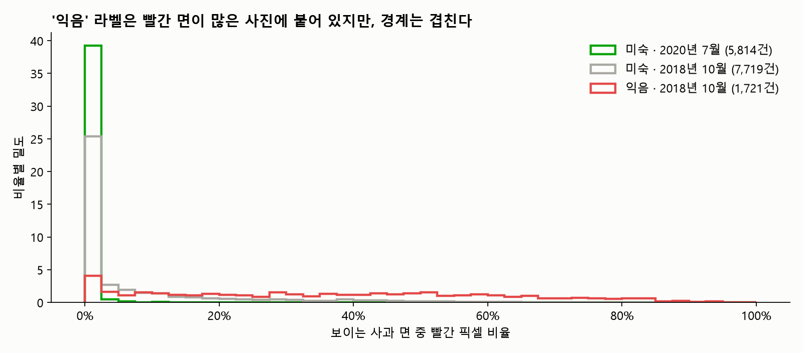

# 정해린 · 익음도 모델 보강 (데이터 확장 + 미세조정)

2026년 11월 17일 실행 · 기존 익음도 분류층이 덜 익은 사과를 많이 "익음"으로 고르는 문제를 보강했다.

## 결론

- **원인은 학습 부족보다 문턱과 라벨 구조다.** 기존 모델도 순위를 매기는 능력(AUC)은 0.90이었다. 기존 문턱은 익음을 놓치지 않는 쪽(균형 정확도)으로 골라서 "익음" 판정의 정밀도가 0.36이었다.
- **학습 데이터를 늘리고 ResNet18 뒤쪽 층을 미세조정했다.** 같은 평가 사진에서 균형 문턱 정밀도가 0.36 → 0.48~0.59로 올랐다. 합성 잎 50% 가림에서 평균 정밀도(AP)는 0.53 → 0.64로 올랐다. 가림 없는 사진의 AP는 0.66 → 0.67~0.69로 95% 구간 안의 차이다.
- **평가 자료의 익음 라벨 460건은 모두, 다른 사진에서는 "미숙"으로도 라벨된 사과에서 나왔다.** 라벨이 사과가 아니라 사진에 보이는 면을 따르는 것으로 보인다. 사진 한 장 단위 성능은 학습만으로 크게 오르기 어렵다.
- **사과 단위로 모으면 차이가 커진다.** 사과별 평균 점수와 "익음 라벨이 붙은 사진 비율"의 순위 상관이 0.29~0.33 → 0.40~0.48이었다. 로봇에서는 같은 사과의 여러 프레임을 모아 판단하는 쪽이 맞다.


## '익음' 라벨의 기준

Fuji-Ripeness-Size 저자들은 사진마다 사과 하나씩 VIA로 박스를 그리고 겉면이 **대부분 빨갛게 보이면 익음, 대부분 초록이면 미숙**으로 붙였다. 판단 근거는 빨간 면이 차지하는 비율이었다. 촬영일은 참고로만 썼다. 2018년 10월 3일(BBCH 85)은 대부분 익은 시기, 2020년 7월 16일(BBCH 77)은 대부분 덜 익은 시기다. 숫자 문턱이나 색표는 논문에 없다. [arXiv 2502.01850, 2.1절](https://arxiv.org/abs/2502.01850)

- 익음 라벨 1,738건 중 1,718건이 2018년 10월 사진에 있다.
- 라벨이 사과가 아니라 사진마다 붙어서, 같은 사과도 보이는 면에 따라 라벨이 달라진다. 아래 ④번 줄처럼 거의 같은 사진이 서로 다른 라벨을 받은 경우도 있다.
- 사진의 %는 보이는 면 중 색상이 빨강(0±20°)이고 채도 0.25 이상인 픽셀의 비율이다. 저자 기준을 설명하려고 만든 근사값이다. 햇빛을 받은 분홍빛 면은 채도가 낮아 적게 잡힌다. 라벨별 중앙값은 익음 35%, 미숙 0%다. [사과별 값](results/red_share.csv) · [요약](results/red_share_summary.json)




## 데이터

사과 ID가 연결된 Fuji-Ripeness-Size 영역 15,271건을 다시 나눴다([prepare_data.py](prepare_data.py)).

| 분할 | 영역 | 익음 | 사과 | 비고 |
|---|---:|---:|---:|---|
| 학습 | 2,491 | 195 | 274 | 기존 학습 895건(익음 90) |
| 검증 | 1,151 | 170 | 84 | 평가 외 사과 중 해시로 1/5 |
| 평가 | 3,023 | 460 | 115 | 기존 평가 사과 115개 고정. 기존 평가 202건 포함 |

- 사과 ID와 사진(타일)이 분할 사이에 겹치지 않게 했다. 다른 분할 사과가 함께 찍힌 타일의 영역 8,606건은 쓰지 않았다.
- 기존 모델이 학습·검증에 쓴 타일은 평가에 넣지 않았다.
- 자르기와 합성 잎은 기존 코드를 그대로 썼다. 기존 평가 202건의 가림 사진도 같은 키로 다시 만들었다.

## 비교 결과 · 평가 3,023장

| 모델 | 검증 AP | 평가 AP (사과 단위 95% 구간) | AUC | 균형 문턱 정밀도 / 재현율 | 잎 50% AP |
|---|---:|---:|---:|---:|---:|
| 기존 분류층 (가림증강) | 0.84 | 0.66 (0.43~0.78) | 0.90 | 0.36 / 0.93 | 0.53 |
| 같은 방식 + 데이터 확장 | 0.75 | 0.68 (0.48~0.80) | 0.92 | 0.45 / 0.89 | 0.57 |
| 미세조정 시드 0·1·2 | 0.86~0.88 | 0.67~0.69 (약 0.48~0.79) | 0.92~0.93 | 0.48~0.59 / 0.73~0.90 | 0.64~0.65 |

- 기존 분류층의 검증 AP는 새 검증 자료로 계산했다. 이 자료에는 기존 모델이 학습한 사과가 섞여 있을 수 있어 기존 모델 쪽에 유리하다.
- 검증 AP(0.86~0.88)와 평가 AP(0.67~0.69)의 차이가 크다. 검증에서 "익음 판정 정밀도 80%"로 정한 문턱이 평가에서는 64~67%에 그쳤다. 문턱은 평가 사과의 성격에 따라 흔들린다.
- 기존 평가 202건만 보면 AP는 0.67(기존)과 0.66~0.67(미세조정)으로 같다.

미세조정 설정: ImageNet ResNet18, conv1~layer2 고정, layer3·layer4·출력층 학습. AdamW one-cycle, 12에폭, 배치 64. 손실은 미숙/익음 비율만큼 익음에 가중했다. 증강은 원본/합성 잎 중 하나를 고르고, 뒤집기, 90° 회전, 밝기·대비 ±10%를 줬다. 색이 라벨의 근거라 색조는 바꾸지 않았다. 에폭은 시드마다 검증 AP가 가장 높은 것을 골랐다(8~10). 저장할 모델도 검증 AP로 골랐다(시드 1). [학습 기록](results/train_log.txt) · [전체 수치](results/metrics.json)

## 실행

```powershell
$pythonPath = 'C:\Users\sclov\PycharmProjects\Graduation-project\.venv\Scripts\python.exe'
& $pythonPath prepare_data.py --data 'D:\Apple-harvest-data\ripeness'
& $pythonPath train_compare.py --device cuda
& $pythonPath make_figures.py
```

`cache/`(약 1.4 GB)와 `weights/ripeness_finetuned.pt`(43 MB)는 저장소에 올리지 않는다. RTX 5070 Laptop GPU에서 학습·평가 전체가 약 2분 걸렸다.
