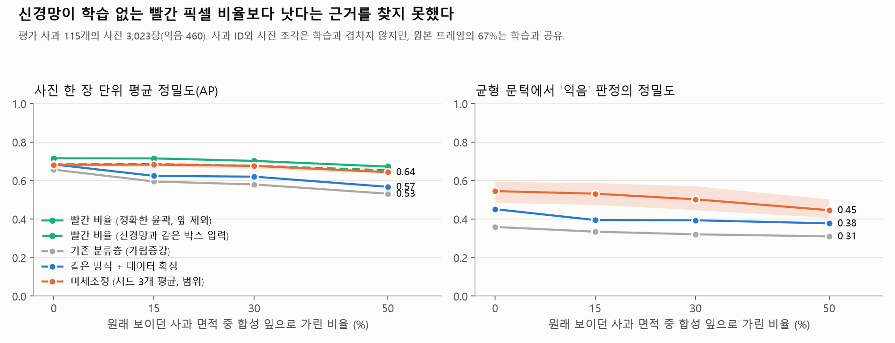
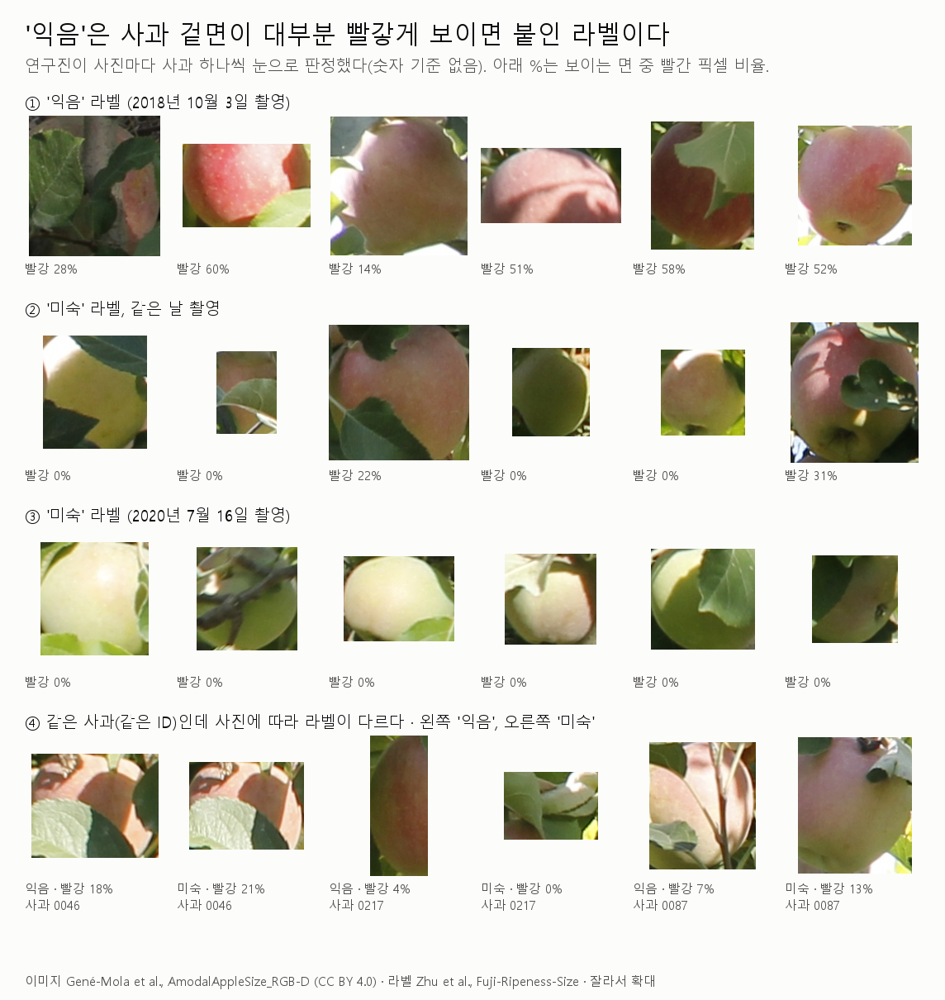
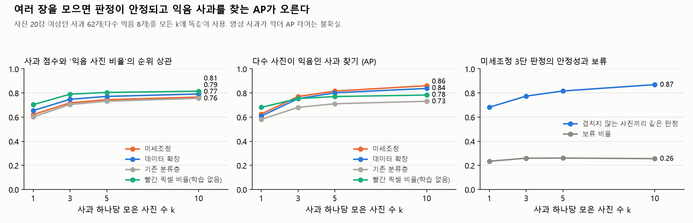
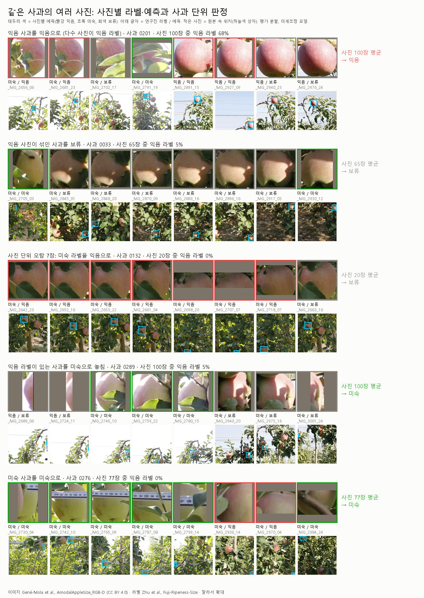
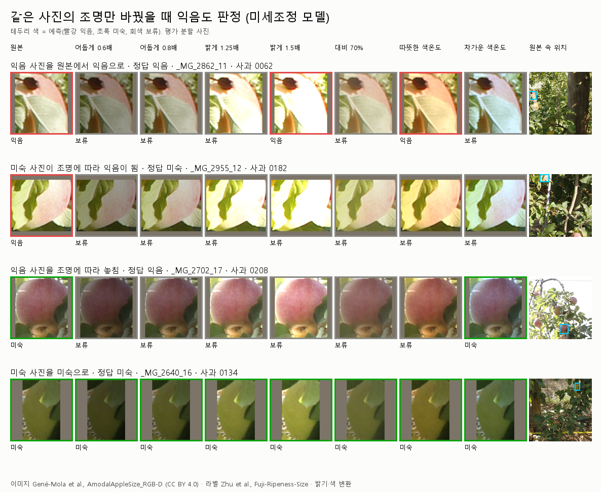

# 정해린 · 익음도 모델 보강 (데이터 확장 + 미세조정)

2026년 11월 17일 실행, 23일 정정 · 기존 익음도 분류층이 덜 익은 사과를 많이 "익음"으로 고르는 문제를 보강했다.

## 결론

- **현재 신경망이 학습 없는 빨간 픽셀 비율보다 낫다는 근거는 없다.** 가림 없는 AP는 빨간 비율 0.72(신경망과 같은 박스 입력이면 0.68), 신경망 0.66~0.69다. 합성 잎 50%에서는 빨간 비율 0.67(박스 0.65), 미세조정 0.64~0.65다. [기준선](results/baseline.json)
- **기존 대비 개선은 주로 데이터 확장에서 나왔다.** 재현율 73%로 맞춘 정밀도는 기존 0.51, 확장 0.59, 미세조정 0.59~0.60, 빨간 비율 0.61이다. 미세조정의 잎 50% AP는 기존보다 높지만(0.53 → 0.64) 색 기준보다 높지는 않다.
- **라벨이 흔들린다.** 같은 사진의 겹친 조각에서 익음이 포함된 510묶음 중 207묶음(41%)의 라벨이 달랐다. 경계에서 잘린 조각을 빼면 54묶음 중 7묶음(13%)으로 줄어, 보이는 범위의 영향으로 보인다. 평가 익음 460건은 모두 다른 사진에서 미숙 라벨도 받은 사과다.
- **여러 장을 모으면 판정이 안정된다.** 사과 전체 사진으로 본 순위 상관은 기존 0.72, 미세조정 0.71~0.74로 차이가 없다. 이전의 "0.29~0.33 → 0.40~0.48"은 동점 처리 오류였다.



## '익음' 라벨의 기준

Fuji-Ripeness-Size 저자들은 사진마다 사과 하나씩 VIA로 박스를 그리고 겉면이 **대부분 빨갛게 보이면 익음, 대부분 초록이면 미숙**으로 붙였다. 판단 근거는 빨간 면이 차지하는 비율이었다. 촬영일은 참고로만 썼다. 2018년 10월 3일(BBCH 85)은 대부분 익은 시기, 2020년 7월 16일(BBCH 77)은 대부분 덜 익은 시기다. 숫자 문턱이나 색표는 논문에 없다. [arXiv 2502.01850, 2.1절](https://arxiv.org/abs/2502.01850)

- 익음 라벨 1,738건 중 1,718건이 2018년 10월 사진에 있다.
- 라벨이 사과가 아니라 사진마다 붙어 같은 사과도 라벨이 달라진다. 아래 ④번 줄처럼 비슷한 사진의 라벨이 다른 경우도 있다.
- 사진의 %는 보이는 면 중 색상이 빨강(0±20°)이고 채도 0.25 이상인 픽셀의 비율이다. 저자 기준을 설명하려고 만든 근사값이다. 햇빛을 받은 분홍빛 면은 채도가 낮아 적게 잡힌다. 라벨별 중앙값은 익음 35%, 미숙 0%다. [사과별 값](results/red_share.csv) · [요약](results/red_share_summary.json)




## 같은 사과를 여러 장 모아 판단하기 (11월 21일)

사진 20장 이상인 사과 62개(다수 사진이 익음 8개)를 모든 k에 똑같이 썼다. 1,000번 섞어 서로 겹치지 않는 두 묶음의 k장을 평균했다. [multiview.py](multiview.py) · [수치](results/multiview.json)

| 사과당 사진 k | 1 | 3 | 5 | 10 |
|---|---:|---:|---:|---:|
| 순위 상관 · 미세조정 | 0.62 | 0.72 | 0.74 | 0.77 |
| 순위 상관 · 빨간 비율 | 0.70 | 0.79 | 0.80 | 0.81 |
| 다수 익음 사과 찾기 AP · 미세조정 | 0.63 | 0.77 | 0.82 | **0.86** |
| 같은 AP · 데이터 확장 | 0.61 | 0.75 | 0.80 | 0.84 |
| 같은 AP · 기존 분류층 | 0.58 | 0.68 | 0.71 | 0.73 |
| 같은 AP · 빨간 비율 | 0.68 | 0.75 | 0.77 | 0.78 |
| 겹치지 않는 사진끼리 같은 3단 판정 · 미세조정 | 0.68 | 0.77 | 0.82 | **0.87** |
| 보류 비율 · 미세조정 | 0.23 | 0.26 | 0.26 | 0.26 |

영상에서 같은 사과를 추적하는 기능이 필요한 근거다. 양성 사과가 8개뿐이라 방법 사이의 AP 차이는 확정할 수 없다.



사례 사진은 원본 속 위치, 사진별 라벨/예측, 사과 단위 판정을 보여 준다. 사진 6장 이상인 사과 중 익음 라벨이 0장인데 전체 평균으로 익음이 된 사과는 없어서, 사진 단위 오탐 사례(사과 0132)를 넣었다.



## 조명 변화 (발표자료 11쪽, 11월 21일)

평가 사진 3,023장의 사과 영역만 밝기·대비·색온도를 바꿔 다시 판정했다. 학습 때 증강은 밝기·대비 ±10%뿐이었다. [lighting.py](lighting.py) · [수치](results/lighting.json)

| 조건 | 미세조정 AP | 익음 판정 정밀도 | 익음을 찾은 비율 | 원본과 판정이 달라진 사진 | 기존 분류층 AP |
|---|---:|---:|---:|---:|---:|
| 원본 | 0.674 | 0.67 | 0.61 | — | 0.656 |
| 어둡게 0.6배 | 0.670 | 0.70 | 0.48 | 10.0% | 0.627 |
| 어둡게 0.8배 | 0.667 | 0.68 | 0.57 | 4.7% | 0.647 |
| 밝게 1.25배 | 0.657 | 0.65 | 0.64 | 8.1% | 0.643 |
| 밝게 1.5배 | 0.637 | 0.61 | 0.69 | 15.7% | 0.637 |
| 대비 70% | 0.651 | 0.73 | 0.43 | 10.9% | 0.631 |
| 따뜻한 색온도 | 0.655 | 0.59 | 0.69 | 12.7% | 0.632 |
| 차가운 색온도 | 0.670 | 0.71 | 0.49 | 8.5% | 0.666 |

- 점수로 줄 세우는 능력(AP)은 조명에 크게 흔들리지 않는다. 최대 0.04 내려갔다.
- 문턱 근처의 판정은 바뀐다. 밝거나 따뜻한 빛에서는 익음 쪽으로, 어둡거나 차갑거나 대비가 낮으면 미숙 쪽으로 기운다.
- 현장에서는 노출·화이트밸런스를 맞추거나, 조명 증강을 넓혀 다시 학습해야 한다.



## 데이터

사과 ID가 연결된 Fuji-Ripeness-Size 영역 15,271건을 다시 나눴다([prepare_data.py](prepare_data.py)).

| 분할 | 영역 | 익음 | 사과 | 비고 |
|---|---:|---:|---:|---|
| 학습 | 2,491 | 195 | 274 | 기존 학습 895건(익음 90) |
| 검증 | 1,151 | 170 | 84 | 평가 외 사과 중 해시로 1/5 |
| 평가 | 3,023 | 460 | 115 | 기존 평가 사과 115개 고정. 기존 평가 202건 포함 |

- 사과 ID와 사진 조각(타일)은 분할 사이에 겹치지 않는다. 다만 **평가 원본 프레임 538장 중 360장(67%)은 학습, 327장은 검증 프레임과 같다.** 다른 분할 사과가 함께 찍힌 타일의 영역 8,606건은 쓰지 않았다.
- 기존 모델이 학습·검증에 쓴 타일은 평가에 넣지 않았다.
- 자르기와 합성 잎은 기존 코드를 그대로 썼다. 기존 평가 202건의 가림 사진도 같은 키로 다시 만들었다.

## 비교 결과 · 평가 3,023장

| 모델 | 검증 AP | 평가 AP (사과 단위 95% 구간) | AUC | 균형 문턱 정밀도 / 재현율 | 잎 50% AP |
|---|---:|---:|---:|---:|---:|
| 기존 분류층 (가림증강) | 0.84 | 0.66 (0.43~0.78) | 0.90 | 0.36 / 0.93 | 0.53 |
| 같은 방식 + 데이터 확장 | 0.75 | 0.68 (0.48~0.80) | 0.92 | 0.45 / 0.89 | 0.57 |
| 미세조정 시드 0·1·2 | 0.86~0.88 | 0.67~0.69 (약 0.48~0.79) | 0.92~0.93 | 0.48~0.59 / 0.73~0.90 | 0.64~0.65 |
| 빨간 비율, 정확한 윤곽 (학습 없음) | — | 0.72 | — | — | 0.67 |
| 빨간 비율, 박스 입력 (학습 없음) | — | 0.68 | — | — | 0.65 |

- 기존 분류층의 검증 AP는 새 검증 자료로 계산했다. 이 자료에는 기존 모델이 학습한 사과가 섞여 있을 수 있어 기존 모델 쪽에 유리하다.
- 검증 AP(0.86~0.88)와 평가 AP(0.67~0.69)의 차이가 크다. 검증에서 "익음 판정 정밀도 80%"로 정한 문턱이 평가에서는 64~67%에 그쳤다.
- 균형 문턱의 정밀도는 재현율이 서로 달라 모델 사이에 바로 비교하지 않는다.
- 학습·검증에 없던 프레임의 422영역(익음 50)만 보면 AP는 빨간 비율 0.75, 기존 0.59, 확장 0.66, 미세조정 0.64~0.70이다.
- 기존 평가 202건만 보면 AP는 0.67(기존)과 0.66~0.67(미세조정)으로 같다.

미세조정 설정: ImageNet ResNet18, conv1~layer2 고정, layer3·layer4·출력층 학습. AdamW one-cycle, 12에폭, 배치 64. 손실은 미숙/익음 비율만큼 익음에 가중했다. 증강은 원본/합성 잎 중 하나를 고르고, 뒤집기, 90° 회전, 밝기·대비 ±10%를 줬다. 색이 라벨의 근거라 색조는 바꾸지 않았다. 에폭은 시드마다 검증 AP가 가장 높은 것을 골랐다(8~10). 저장할 모델도 검증 AP로 골랐다(시드 1). [학습 기록](results/train_log.txt) · [전체 수치](results/metrics.json)

## 실행

```powershell
$pythonPath = 'C:\Users\sclov\PycharmProjects\Graduation-project\.venv\Scripts\python.exe'
& $pythonPath prepare_data.py --data 'D:\Apple-harvest-data\ripeness'
& $pythonPath train_compare.py --device cuda
& $pythonPath baseline.py            # 빨간 비율 기준선
& $pythonPath make_figures.py
& $pythonPath label_examples.py      # 익음 라벨 기준 사진 (약 3분)
& $pythonPath multiview.py          # 여러 장 모아 판단
& $pythonPath lighting.py --device cuda   # 조명 변화
```

`cache/`(약 1.4 GB)와 `weights/ripeness_finetuned.pt`(43 MB)는 저장소에 올리지 않는다. RTX 5070 Laptop GPU에서 학습·평가 전체가 약 2분 걸렸다.
