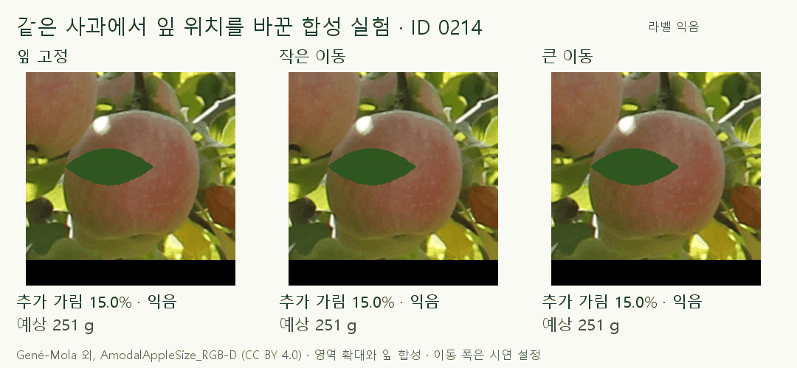

# 정해린 · 통합 데모의 잎 움직임 실험

2026년 11월 17일 실행, 23일 재실행(사진 경계 판정 수정, 데모 익음도를 색 특징 모델로, 지름을 모양 특징 모델로 교체). 현재 통합 데모의 익음도 모델과 지름·무게 계산을 그대로 불러와, 같은 사과 앞에서 합성 잎이 움직일 때 출력이 얼마나 바뀌는지 확인했다.

## 먼저 반영한 기존 검증

프로젝트의 `무게검증/README.md`에는 사과를 지운 배경에서도 RGB 기반 무게 오차가 낮게 나온 비교가 있다. 앞서 보고한 **이미지 회귀 14.26 g·13.41 g**에는 카메라와 배경 단서가 영향을 줄 수 있으므로, 사과 크기를 읽는 성능 향상으로 해석하기 어렵다.

이번 실험은 현재 `통합데모/demo.py`가 사용하는 **지름 → 예상 무게 식**을 쓴다. 과수원 사과의 실측 무게가 없어, 여기서는 예상 무게의 프레임별 변화와 보류 여부를 기록했다.

## 입력과 조건

- 기존 데모 사진 5장에서 최신 익음도 분할이 `test`인 ID만 골랐다.
- 데모 사진의 평가 분할 사과 중 지름을 낼 수 있는(참고 추정 포함) **26개 관측 사례, 서로 다른 사과 15개**를 사용했다. 이전 보류 규칙에서는 5사례였다.
- 각 사례에 처음 보이던 사과 면적의 약 **15%**를 덮는 합성 잎을 만들었다. 잎의 모양·초기 위치는 세 조건에서 같다.
- 잎 고정, 작은 이동(보이는 사과 폭의 ±5%), 큰 이동(±20%)을 각각 **12프레임**씩 만들었다. 조건마다 312프레임, 합계 **936프레임**이다. 이동 방향과 위치는 고정 시드로 재현한다.
- RGB·가시 마스크에서 잎 영역을 함께 처리하고, 잎 아래 깊이는 0(알 수 없음)으로 갱신했다. 각 프레임의 남은 가시 영역으로 박스를 다시 잘라 익음도를 예측했다.

가시 마스크는 데이터의 정답 마스크에 합성 잎을 정확하게 빼서 만든다. 실제 검출·분할기가 잎을 놓치거나 사과 경계를 틀리는 오차는 이번 측정에 추가로 들어가야 한다. 잎 이동은 화면상 모의 조건이고 실제 풍속을 뜻하지 않는다.

## 관측 결과

판정 전환은 같은 12프레임 안에서 인접한 두 프레임의 익음·미숙·보류 표시가 달라진 횟수다.

| 조건 · 각 312프레임 | 익음도 판정 전환 | 익음도 보류 프레임 | 지름 없음(깊이 부족) | 사례별 예상 무게 변화 폭 · 중앙값 / 최대 | 신뢰도 표시 전환 |
|---|---:|---:|---:|---:|---:|
| 잎 고정 | **0회** | 132 | 0 | 0 / 0 g | 0회 |
| 작은 이동 | **4회** | 135 | 0 | 1.2 / 11.2 g | 2회 |
| 큰 이동 | **23회** | 143 | 0 | 3.7 / 20.5 g | 14회 |

이제 잎이 움직여도 대부분의 프레임에서 지름·예상 무게를 낸다. 큰 이동에서 무게 변화 폭은 사례 절반이 3.7 g 이하였고 가장 큰 사례는 20.5 g이었다. 판정 전환은 큰 이동에서 늘었는데, 사례 수(5 → 26)가 늘고 가려진 사과가 많이 포함됐기 때문이다.

사과 ID `0214`의 사례는 큰 이동에서 익음도 판정이 3번 바뀌었고 예상 무게 변화 폭은 **약 0.9 g**(작은 이동 1.8 g)이었다. 이 값은 해당 합성 사례의 출력 변화다. 과수원 무게 예측의 오차를 뜻하지 않는다. [사례별 범위](results/sequences.csv) · [모든 프레임의 출력](results/frames.csv)



## 3프레임 점수 중앙값도 비교

현재 프레임과 이전 두 프레임의 익음도 점수 중앙값을 사용해 같은 문턱으로 다시 판정했다. 초반에는 사용할 수 있는 프레임만 썼다. 미래 프레임은 읽지 않는다.

| 조건 | 원래 판정 전환 | 중앙값 적용 후 |
|---|---:|---:|
| 잎 고정 | 0회 | 0회 |
| 작은 이동 | 4회 | 4회 |
| 큰 이동 | 23회 | 13회 |

큰 이동에서는 3프레임 중앙값이 전환을 23회에서 13회로 줄였다. 작은 이동에서는 효과가 없었다. 점수 중앙값은 실제 상태 변화의 표시를 늦출 수도 있다. 이번 결과만으로 적용할 시간 보정 방법을 확정하지 않았다. [점수 보정 결과](results/median3_metrics.json) · [프레임별 원래 판정과 보정 판정](results/median3_frames.csv)

## 재현

현재 PC의 PowerShell에서 이 폴더를 열고 실행한다. 기존 통합 데모가 있는 프로젝트 폴더와 데이터가 필요하다. 모델과 설정은 해당 프로젝트에서 읽는다.

```powershell
$pythonPath = 'C:\Users\sclov\PycharmProjects\Graduation-project\.venv\Scripts\python.exe'
& $pythonPath evaluate_motion.py --project-root 'C:\apple-harvest-vision\haerin\2026-11-16' --data 'D:\Apple-harvest-data' --out '.\재실행결과' --device cuda
& $pythonPath stabilize.py --results '.\재실행결과'
```

GPU 연산에는 TF32를 끄고 결정적 cuDNN 설정을 사용했다. 원본 binary 마스크의 지름 계산이 기존 단일 다각형 계산과 일치하는지도 5사례 모두 확인했다. 합성 잎으로 윤곽에 구멍이 생기거나 영역이 나뉘어도 남은 픽셀 전체로 계산한다. 실행에 쓴 모델·데모 코드·지름 및 무게 설정의 SHA-256은 [실험 설정](results/metrics.json)에 남겼다.

## 자료 출처

Gené-Mola 외, AmodalAppleSize_RGB-D. 과수원 RGB·깊이·가시 윤곽을 사용하고 사진 확대, 합성 잎, 결과 표기를 추가했다. 익음도 모델은 팀 프로젝트의 `익음도보강`, 지름·무게는 `지름추정`·`무게추정`의 기존 결과를 사용했다. [데이터](https://doi.org/10.34810/data916) · [CC BY 4.0](https://creativecommons.org/licenses/by/4.0/)
