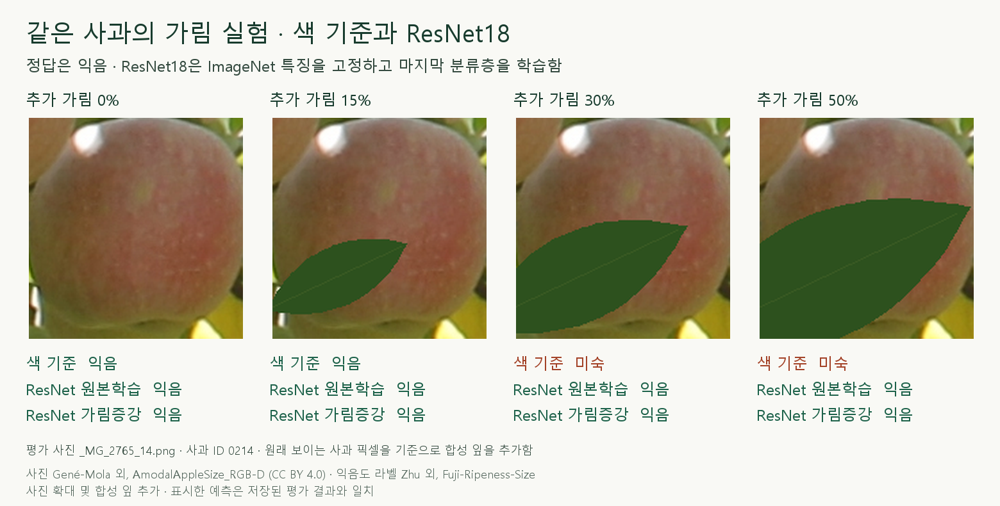
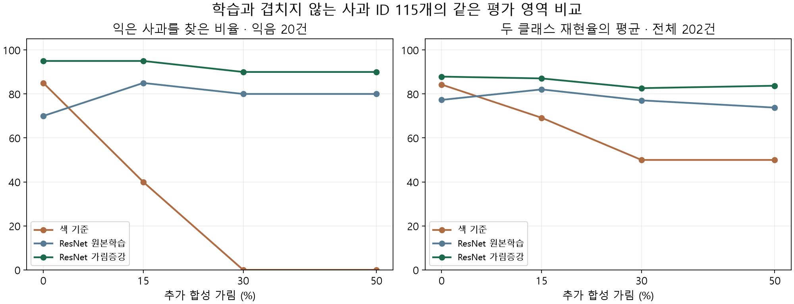
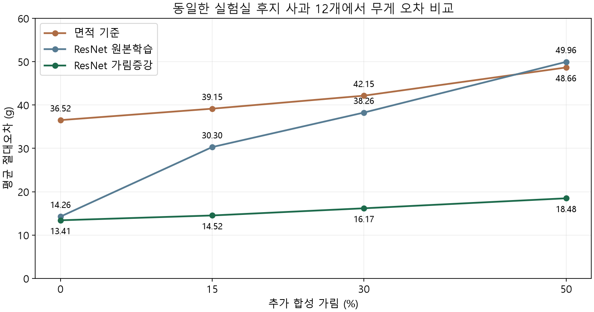

# 정해린 · ResNet18 전이학습 결과

2026년 11월 16일 실행 · 익음도, 무게, 추가 잎 가림을 같은 평가 자료에서 비교했다.

**ImageNet-1K로 사전학습된 ResNet18을 실제로 불러와 사과 예측층을 학습했다.** 이번 단계에서는 합성곱층과 배치 정규화를 고정해 512개 이미지 특징을 추출했다. 익음도는 두 클래스를 구분하는 선형 분류층, 무게는 g 단위 값을 예측하는 회귀층을 각각 학습했다. 익음도와 무게에 서로 다른 사과 자료와 학습층을 쓴다.

## 익음도 결과

기존 실험과 같은 사과 ID 115개의 **202개 관측 영역**을 평가했다. 이 중 익음은 20건, 미숙은 182건이다. 익음 20건은 실제 ID 13개에서 나왔으며 같은 과실의 다른 사진도 포함한다.

| 추가 합성 가림 | 색 기준 익음 검출 | ResNet 원본학습 익음 검출 | ResNet 가림증강 익음 검출 | 증강 모델이 미숙을 익음으로 잘못 고른 수 |
|---|---:|---:|---:|---:|
| 0% | 17/20 | 14/20 | **19/20** | 35/182 |
| 15% | 8/20 | 17/20 | **19/20** | 38/182 |
| 30% | 0/20 | 16/20 | **18/20** | 45/182 |
| 50% | 0/20 | 16/20 | **18/20** | 41/182 |

학습에 가림을 추가한 ResNet의 균형 정확도(익음·미숙 재현율의 평균)는 **87.9%, 87.1%, 82.6%, 83.7%**다. 같은 모델이 원본에서 익음으로 고른 54건 중 실제 익음 라벨은 19건(35.2%)이다. 원본 전체 정확도는 82.2%다. 익은 과실을 더 찾는 것과 미숙을 잘못 고르는 것을 함께 확인해야 한다. [전체 지표](ripeness/results/metrics.json) · [관측별 정답·예측](ripeness/results/predictions.csv)





학습은 기존과 같은 895영역, 검증은 338영역이다. 사과 ID와 원본 촬영 프레임이 분할에 겹치지 않는지 코드에서 검사했다. 원본학습은 895개 입력, 증강학습은 같은 학습 영역에 0·15·30·50% 가림을 적용한 3,580개 입력을 썼다. 입력 박스를 긴 변 160픽셀로 줄이고 비율을 보존해 정사각형에 붙였다. 특징의 평균·표준편차는 학습 자료에서 구했고, 분류 임계값은 원본 검증 자료의 균형 정확도로 골랐다. 기존 색 기준은 학습 자료에서 임계값을 골랐으므로 두 방법의 임계값 선택 절차에 차이가 있다.

## 무게 결과

기존과 같은 **학습 과실 48개, 평가 과실 12개**를 썼다. 과실당 실내·기본 바닥·중간 거리·위에서 찍은 한 장을 사용했다. 원본 화면에서의 크기 비율을 보존해 전체 프레임을 224×224에 맞추고, RGB 특징만으로 예측했다. 사진명·실측 무게·EXIF 카메라 기종은 모델의 입력 특징에서 제외했다.

| 추가 합성 가림 | 기존 면적 기준의 평균 절대오차 | ResNet 원본학습 | ResNet 가림증강 |
|---|---:|---:|---:|
| 0% | 36.52 g | **14.26 g** | **13.41 g** |
| 15% | 39.15 g | 30.30 g | **14.52 g** |
| 30% | 42.15 g | 38.26 g | **16.17 g** |
| 50% | 48.66 g | 49.96 g | **18.48 g** |

원본에서 50% 추가 가림으로 같은 과실의 예상 무게가 변한 절대량의 평균도 **43.21 g에서 14.37 g**으로 줄었다. 회귀 정규화 계수 0.1은 실행 전에 고정했다. 평가 자료로 계수를 고르는 단계는 수행하지 않았다. 증강학습은 같은 학습 과실 48개에서 만든 192개 입력을 사용했다. [회귀 지표·설정](weight/results/weight_transfer_metrics.json) · [각 사과의 실제 무게·예측·오차](weight/results/weight_transfer_predictions.csv)



실험실 자료에서는 카메라별 무게 범위가 겹치지 않고 배경·촬영 배율에도 촬영기관의 특징이 있을 수 있다. 평가용 과실 12개는 학습과 분리됐지만, 처음 보는 카메라·과수원에서의 정확도를 확인하려면 별도 자료가 필요하다.

## 실행과 저장된 모델

실행 환경은 Python 3.11.9, PyTorch 2.12.0+cu130, TorchVision 0.27.0+cu130, NumPy 2.4.6, Pillow 12.3.0이다. **RTX 5070 Laptop GPU에서 실제 특징 추출과 예측을 실행했다.** 분류층 최적화와 회귀 계산은 CPU에서 수행했다.

현재 PC에 준비된 환경은 아래 경로다. PowerShell에서 이 폴더를 연 뒤 사용한다.

```powershell
$pythonPath = 'C:\Users\sclov\PycharmProjects\Graduation-project\.venv\Scripts\python.exe'
& $pythonPath predict.py --task weight --image 'D:\Apple-harvest-data\weight\Fuji_1\146.54\Rio_M_Fuji_146,54_Spb_int_me_ver.JPG' --head '.\weight\results\weight_transfer_heads.npz' --variant aug --weights '.\weights\resnet18-f37072fd.pth'
& $pythonPath predict.py --task ripeness --image 'D:\Apple-harvest-data\ripeness\test\images\_MG_2669_18.png' --box 342 1092 474 1157 --head '.\ripeness\results\head_aug.pt' --weights '.\weights\resnet18-f37072fd.pth'
```

익음도는 검출기가 전달한 개별 사과 영역을 입력으로 쓴다. `--box`의 오른쪽·아래 좌표는 범위에서 제외하는 값이다. 무게는 같은 촬영 조건의 전체 프레임을 입력으로 쓴다. 입력 JPG의 회전 보정·축소도 학습 때와 같은 함수를 쓴다. 독립적으로 저장 모델을 다시 읽어 원본 JPG와 사과 영역을 예측했다. GPU 배치 크기가 달라지면 작은 실수 연산 차이가 생길 수 있다.

처음부터 재실행할 때에는 이전 검수·분할이 있는 폴더를 지정한다. 아래는 프로젝트 안에 저장한 위치 기준이다. 캐시에는 약 350 MiB가 필요하다.

```powershell
& $pythonPath run_all.py --data 'D:\Apple-harvest-data' --baseline-root 'C:\apple-harvest-vision\haerin\2026-11-16' --weights '.\weights\resnet18-f37072fd.pth' --cache '.\cache' --out '.\재실행결과' --device cuda
```

별도 Python 환경을 만들 때 필요한 버전은 `requirements.txt`에 있다. GPU용 설치는 CUDA 13.0 배포본을 사용했다.

```powershell
python -m pip install torch==2.12.0 torchvision==0.27.0 --index-url https://download.pytorch.org/whl/cu130
python -m pip install numpy==2.4.6 Pillow==12.3.0 matplotlib==3.11.1
```

파일 구성은 다음과 같다.

- `weights/resnet18-f37072fd.pth` — 공식 ImageNet 특징 추출 가중치, SHA-256을 읽을 때 검증한다.
- `ripeness/results/head_clean.pt`, `head_aug.pt` — 학습한 분류층과 정규화·임계값.
- `weight/results/weight_transfer_heads.npz` — 학습한 두 회귀층의 계수와 절편.
- `results/*.csv` — 검증·평가 예측값, `results/*.json` — 조건별 수치와 설정.
- `predict.py` — 새 입력의 예측, `run_all.py` — 같은 실험 재실행.

### 출처와 데이터 해석

ResNet18은 TorchVision의 **IMAGENET1K_V1** 공식 파일을 사용했다. 전체 SHA-256은 `f37072fd47e89c5e827621c5baffa7500819f7896bbacec160b1a16c560e07ec`다. 이번 160픽셀 사과 크롭과 전체 화면 보존 전처리는 실험에 맞춰 정한 설정이다. [공식 모델 문서](https://docs.pytorch.org/vision/stable/models/generated/torchvision.models.resnet18.html)

합성 가림률은 **원래 보이던 과실 픽셀 중 추가로 덮은 비율**이다. 실제 잎의 움직임이나 촬영 조명을 바꾼 현장 실험은 별도로 평가해야 한다. 익음도 라벨은 연구진이 색·촬영일로 부여한 판정을 보존했다. 일부 같은 ID에 사진별로 서로 다른 라벨이 있었다. 앞선 검수 기록의 라벨 정의와 연결 기준을 사용한다. [익음도 자료](https://github.com/zhukeyi-stan/Fuji_Ripeness_And_Size_Estimation) · [가림·RGB 자료 및 CC BY 4.0](https://doi.org/10.34810/data916) · [실측 무게 자료 및 CC BY-NC-SA 4.0](https://datos.gob.es/en/catalogo/ea0041268-integralimenta-apple-fruit-laboratory-images-dataset)
