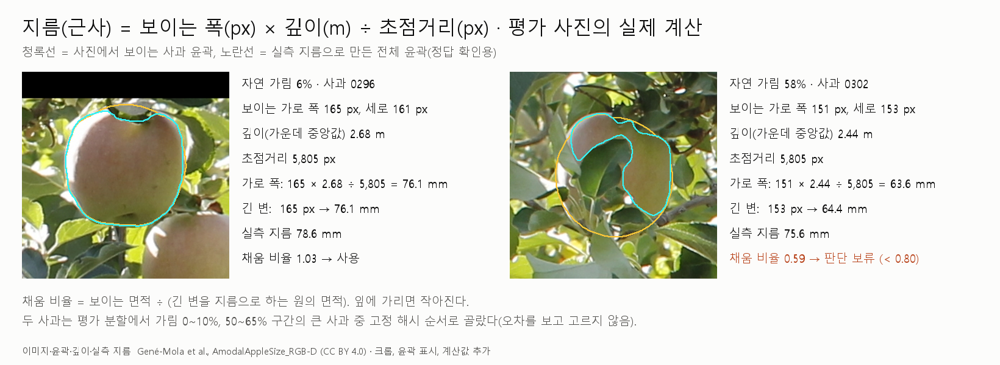
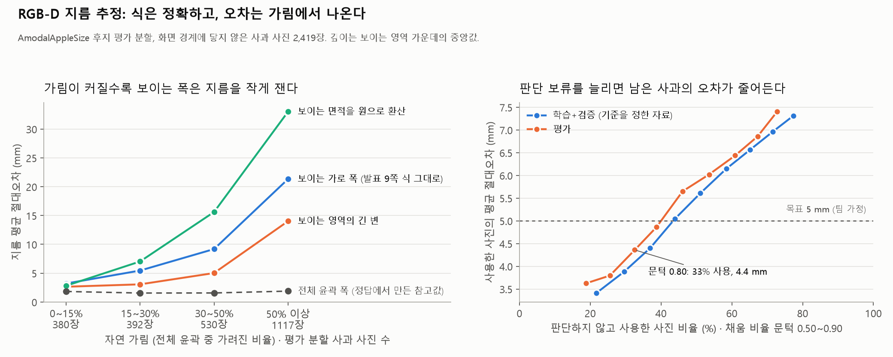

# 정해린 · RGB-D 사과 지름 추정

2026년 11월 16일 실행 · 발표자료 9쪽의 식을 실제 RGB-D 자료에 적용하고 캘리퍼 실측 지름과 비교했다.

## 결론

**식 자체는 정확하다.** 사과의 전체 윤곽 폭을 알면 평가 분할에서 평균 절대오차가 **1.8 mm**였다. 깊이·초점거리·핀홀 식을 조합한 계산이 맞다는 뜻이다. 전체 윤곽은 실측 지름으로 만든 정답 자료라 실제 로봇에서는 쓸 수 없고, 깊이 오차만 따로 보는 참고값이다.

**오차는 잎 가림에서 나온다.** 실제로 쓸 수 있는 것은 사진에서 보이는 윤곽이다. 보이는 영역의 긴 변을 쓰면 가림 15% 미만에서 **2.7 mm**, 가림 50% 이상에서 **14.0 mm**였다. 평가 사진의 46%가 가림 50% 이상이다. 보이는 폭은 항상 지름을 작게 잰다.

**보이는 윤곽만으로 판단 보류를 정할 수 있다.** 다음 두 경우 판단을 보류한다.
- 보이는 면적이 긴 변 원의 80%에 못 미칠 때
- 깊이 값이 절반 넘게 비었을 때

이 규칙을 적용하면 평가 사진의 **32%**를 사용하고, 사용한 사진의 오차는 **4.4 mm**(중앙값 2.9 mm)였다. 보류한 사진의 오차는 10.5 mm였다.

**발표 9쪽의 "가로 폭"은 "보이는 영역의 긴 변"으로 바꾸는 것이 좋다.** 같은 평가 사진에서 가로 폭은 13.3 mm, 긴 변은 8.5 mm였다. 잎이 옆을 가리면 가로 폭이 먼저 줄어들기 때문이다.



## 자료

- **AmodalAppleSize_RGB-D 후지** — Gené-Mola 등, 2023, CC BY 4.0. 발표자료 6쪽의 PApple_RGB-D-Size와 같은 후지 나무 자료다. 두 배포본의 사진이 같은지는 확인하지 않았다. 이 배포본에는 보이는 윤곽과 전체 윤곽이 모두 있어서 가림별 오차를 나눠 볼 수 있다. 이전 검수에서 익음도 자료(Fuji-Ripeness-Size)와는 RGB 3,925장이 바이트 단위까지 일치했다. [데이터 DOI](https://doi.org/10.34810/data916)
- 깊이는 여러 시점 사진으로 만든 SfM·MVS 깊이 지도(m)다. PNG와 같은 1300×1300 좌표계(사방 100 px 검은 여백 포함)에 맞춰져 있다.
- 초점거리는 `focal_length.txt`에서 읽었다. 모든 사진이 5,805.34 px다.
- 실측 지름은 `GT_diameter.txt`의 사과 615개 값이다. 캘리퍼로 잰 최대 가로 지름(mm)이다.
- 보이는 윤곽–전체 윤곽 쌍 15,335건 중 화면 경계·여백에 닿지 않은 **11,173건**을 썼다. 이전 [가림 검수](../occlusion/results/natural_summary.json)와 같은 기준이다. 분할별로 학습 6,140, 검증 2,586, 평가 2,447건이다.

## 계산 방법

```
지름(mm) = 폭(px) × 깊이(m) ÷ 초점거리(px) × 1000
```

- **폭 후보** — 보이는 윤곽의 가로 폭(발표 9쪽 식 그대로), 보이는 윤곽의 긴 변, 보이는 면적을 같은 면적의 원 지름으로 바꾼 값. 참고값으로 전체 윤곽의 가로 폭.
- **깊이** — 보이는 윤곽을 3 px 안쪽으로 줄인 영역에서 0이 아닌 깊이의 중앙값이다. 경계에서 배경 깊이가 섞이는 것을 피한다.
- **학습+검증에서 정한 것** — 깊이 대푯값 세 가지(전체 중앙값, 안쪽 중앙값, 안쪽 하위 25%)와 구 중심 보정(겉면 깊이에 지름의 1/3 더하기) 여부. 전체 윤곽 폭으로 깊이 오차만 비교했고, 안쪽 중앙값·보정 없음이 1.76 mm로 가장 작았다. 보정을 하면 이미 양수인 편향이 더 커져 1.9 mm대가 됐다.
- **판단 보류** — 채움 비율 = 보이는 면적 ÷ (긴 변을 지름으로 하는 원의 면적). 0.50~0.90 문턱 중 학습+검증에서 사용 사진의 오차가 **5 mm 이하**가 되는 가장 낮은 값(0.80)을 골랐다. 5 mm는 팀이 정한 가정이며 `--target-mae`로 바꿀 수 있다.
- 평가 분할은 위 선택이 끝난 뒤 한 번만 계산했다. 학습되는 모델 가중치는 없다. 깊이 대푯값과 문턱 두 가지만 학습+검증에서 정했다.

## 결과 · 평가 분할 2,419장

깊이 값이 절반 넘게 빈 28장은 먼저 보류했다.

| 폭 측정 | 평균 절대오차 | 중앙값 | 평균 편향 | 5 mm 이내 | 같은 모양·밀도라면 무게 오차 중앙값 |
|---|---:|---:|---:|---:|---:|
| 보이는 가로 폭 (발표 9쪽) | 13.3 mm | 9.2 mm | −12.9 mm | 31% | 34% |
| **보이는 영역의 긴 변** | **8.5 mm** | 5.2 mm | −7.5 mm | 48% | 21% |
| 보이는 면적을 원으로 환산 | 20.3 mm | 18.0 mm | −20.0 mm | 17% | 60% |
| 참고 · 전체 윤곽 가로 폭 | 1.8 mm | 1.2 mm | +0.9 mm | 95% | 5% |

무게는 지름의 세제곱에 비례한다고 보고 `|(추정/실측)³ − 1|`의 중앙값을 적었다. 실제 무게를 잰 것이 아니다. 지름이 6% 틀리면 무게는 약 19% 틀린다.

| 자연 가림 | 사진 수 | 가로 폭 | 긴 변 | 면적 환산 | 전체 윤곽(참고) |
|---|---:|---:|---:|---:|---:|
| 0~15% | 380 | 3.2 mm | **2.7 mm** | 2.8 mm | 1.8 mm |
| 15~30% | 392 | 5.5 mm | **3.1 mm** | 7.0 mm | 1.6 mm |
| 30~50% | 530 | 9.2 mm | **5.0 mm** | 15.6 mm | 1.6 mm |
| 50% 이상 | 1,117 | 21.3 mm | **14.0 mm** | 33.0 mm | 1.9 mm |



### 판단 보류를 적용했을 때

| | 사진 | 평균 절대오차 | 중앙값 | 평균 편향 | 5 mm 이내 | 자연 가림 중앙값 |
|---|---:|---:|---:|---:|---:|---:|
| 사용 (채움 비율 ≥ 0.80) | 788 (적격 2,447장의 32%) | **4.4 mm** | 2.9 mm | −2.8 mm | 75% | 15% |
| 보류 | 1,631 | 10.5 mm | 7.4 mm | −9.8 mm | 36% | 60% |

학습+검증과 평가의 문턱별 곡선이 거의 겹쳤다. [문턱별 수치](results/hold_tradeoff.csv)

**사과 하나에 값 하나.** 평가 분할에서 사용한 사진이 하나 이상 있는 사과는 175개다. 사과마다 사용한 사진(중앙값 3장)의 추정 중앙값을 쓰면 평균 절대오차 5.8 mm, 중앙값 2.9 mm, 5 mm 이내 73%였다. 평균 편향이 −4.8 mm라 여전히 작게 잰다. [사과별 결과](results/per_apple_test.csv)

### 해 보았지만 쓰지 않은 것

보이는 윤곽 점에 RANSAC으로 원을 맞추는 방법도 평가 분할에서 시험했다. 전체 9.8 mm로 긴 변(8.5 mm)보다 나빴다. 가림 50% 이상에서도 14.8 mm로 나아지지 않았다. 잎 경계가 원의 일부처럼 맞춰지는 경우가 많았다. 코드에는 넣지 않았다.

## 해석과 한계

- 보이는 윤곽은 사람이 그린 정답 윤곽이다. 종호의 YOLO 분할 결과를 넣으면 윤곽 오차가 더해진다. 같은 평가 사진에서 따로 확인해야 한다.
- 깊이는 여러 장의 사진으로 재구성한 값이다. 로봇에 단 RGB-D 카메라의 실시간 깊이는 잡음과 빈 영역이 더 많을 수 있다.
- 평가 분할에 나온 사과 378개 중 367개가 학습·검증 분할의 다른 사진에도 나온다. 이 방법은 학습 가중치가 없고 데이터로 정한 값이 두 개뿐이라 영향은 작다고 본다. 독립 과수원 평가는 아니다.
- 가린 사과의 지름을 살리려면 원 논문처럼 **가려진 부분까지 포함한 전체 윤곽을 예측하는 분할**이 필요하다. 전체 윤곽을 알면 오차가 1.8 mm라는 결과가 그 효과의 상한을 보여 준다. [원 논문](https://doi.org/10.1016/j.compag.2023.107854)
- 영상에서 같은 사과를 추적하면 여러 프레임 중 덜 가린 프레임의 값을 쓸 수 있다(Apple MOTS, 발표자료 5쪽).

## 실행

이 폴더를 PowerShell에서 연다. NumPy·SciPy·Pillow·Matplotlib만 쓰고 GPU는 필요 없다. 실행 환경은 Python 3.11.9, NumPy 2.4.6, SciPy 1.17.1, Pillow 12.3.0, Matplotlib 3.11.1이다.

```powershell
$pythonPath = 'C:\Users\sclov\PycharmProjects\Graduation-project\.venv\Scripts\python.exe'
& $pythonPath measure_instances.py --zip 'D:\Apple-harvest-data\02-annotated_data_fuji.zip'
& $pythonPath evaluate_diameter.py
& $pythonPath make_figures.py --zip 'D:\Apple-harvest-data\02-annotated_data_fuji.zip'
```

첫 단계는 ZIP 안의 깊이 지도 약 3,900장을 읽으므로 몇 분 걸린다. 압축을 풀 필요는 없다. 이전 가림 검수의 `../occlusion/results/natural_occlusion.csv`가 있어야 한다.

- `measure_instances.py` — 15,335쌍의 폭·면적·깊이 통계를 `results/instance_measurements.csv`로 저장
- `evaluate_diameter.py` — 깊이 선택, 지름 계산, 판단 보류, 지표 → `results/metrics.json`, `test_predictions.csv`, `per_apple_test.csv`, `hold_tradeoff.csv`
- `make_figures.py` — 계산 예시와 오차 그래프

계산 예시 그림은 AmodalAppleSize_RGB-D(Gené-Mola 등, CC BY 4.0)의 평가 사진을 잘라 윤곽과 계산값을 덧붙였다. [이용 조건](https://creativecommons.org/licenses/by/4.0/)
