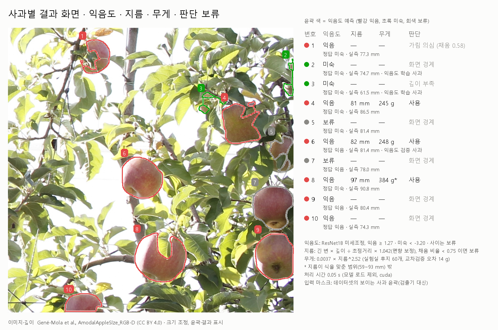
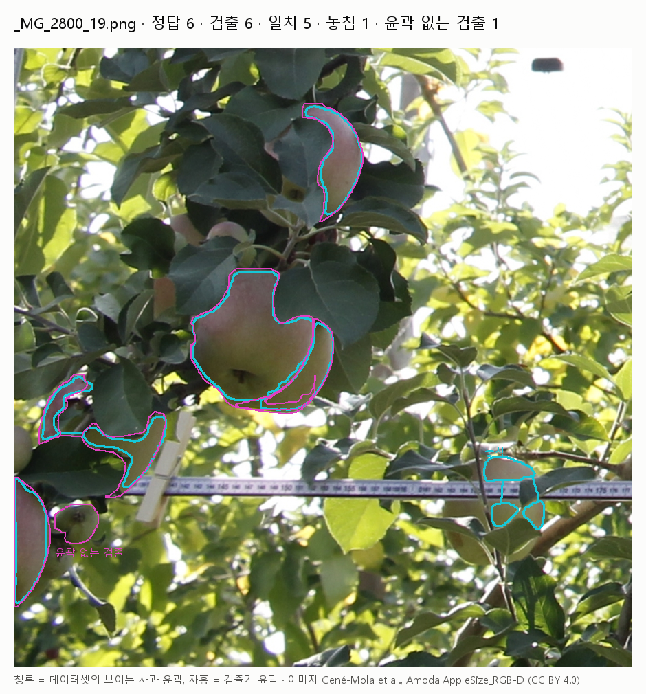

# 정해린 · 통합 데모: 사진 한 장 → 사과별 결과 화면

2026년 11월 16일 작성, 17일 무게 추가 · 발표자료 4쪽의 마지막 단계 "결과 화면"과 13쪽의 "판단 보류"를 하나로 이었다.



## 하는 일

과수원 RGB 사진, 깊이 지도, 사과별 보이는 윤곽을 받아 사과마다 아래 값을 낸다.

| 출력 | 방법 | 근거 |
|---|---|---|
| 익음도 (익음/미숙/보류) | 윤곽의 박스를 잘라 미세조정한 ResNet18로 점수를 낸다. 점수 ≥ 1.27이면 익음, < −3.20이면 미숙, 그 사이는 보류 | [익음도 보강](../익음도보강/README.md). 검증에서 익음 정밀도 80%로 정했지만 평가에서는 67%였다. 색 기준보다 낫다는 근거는 없다 |
| 지름 (mm) | 보이는 영역의 긴 변 × 깊이 중앙값 ÷ 초점거리 × 1.042(편향 보정) | [지름 추정](../지름추정/README.md). 사과 단위 교차검증 4.45 mm, 전체 주석의 23%에 값 |
| 예상 무게 (g) | `0.0037 × 지름^2.52`. 지름을 낸 사과만 계산 | [무게 추정](../무게추정/README.md). 실험실 14.2 g, 과수원 오차는 모름(지름 정의도 다름) |
| 판단 보류 사유 | 사진 경계 10 px 안에 닿음, 깊이 부족(절반 넘게 빔), 가림 의심(채움 비율 0.75 미만) | 학습+검증으로 정한 값. 11월 23일 경계 정정 |

지름의 깊이 대푯값과 보류 문턱은 `../지름추정/results/metrics.json`에서, 편향 보정값은 `bias_calibration.json`에서 읽는다. 무게 식과 범위는 `../무게추정/results/metrics.json`에서 읽는다. 각 실험의 설정을 바꾸면 데모도 같이 바뀐다.

무게는 사진에서 바로 맞히지 않는다. [무게 검증](../무게검증/README.md)에서 그 방식이 사과가 아니라 카메라를 읽는다는 것을 확인했다. 대신 지름 → 무게 식을 쓴다. 지름이 식을 맞춘 범위(59~93 mm) 밖이면 무게 옆에 `*`를 붙인다.

## 종호와 맞출 입력 형식

검출·분할 쪽은 사진마다 `<사진 이름에서 확장자 뺀 것>.json` 파일 하나를 폴더에 넣어 주면 된다.

```json
{"image": "_MG_2669_18.png",
 "instances": [{"id": "0", "score": 0.91, "polygon": [[512, 300], [530, 298], ...]}]}
```

- `polygon`은 **원본 PNG의 픽셀 좌표**다. 1300×1300 파일이면 실제 사진은 137~1160 px에 있고, 여백을 포함한 좌표로 넘긴다. 꼭짓점은 픽셀 중심을 포함하는 정수 좌표로 본다.
- `id`는 그 사진 안에서만 구분되면 된다. `score`는 기록용이며 데모에서 쓰지 않는다.
- `results/*_검출입력예시.json`이 이 형식으로 만든 실제 파일이다. 데이터셋 윤곽을 그대로 옮겼다.

YOLO 결과는 [yolo_to_json.py](yolo_to_json.py)로 이 형식으로 저장한다. Ultralytics의 `Results.masks.xy`를 원본 해상도 마스크로 받아 다각형으로 쓴다. 별도 환경에서 COCO 가중치로 실행해 확인했고, 종호의 best.pt로는 아직 실행하지 않았다.

[compare_detections.py](compare_detections.py)는 검출 JSON과 데이터셋 윤곽을 사과별로 맞춘다(마스크 IoU 0.5 이상, 큰 것부터). 그다음 아래를 계산한다.
- 놓친 사과, 데이터셋 윤곽이 없는 검출, 맞춘 사과의 평균 IoU
- 같은 사과에서 YOLO 윤곽을 넣었을 때 익음도 판정과 지름이 얼마나 바뀌는지

정답 윤곽을 그대로 넣으면 36개 모두 맞고 변화가 0이었다. 일부러 사진마다 사과 하나를 빼고, 가짜 검출 하나를 넣고, 윤곽을 10% 줄이면 놓침 5, 윤곽 없는 검출 5로 잡혔다(경계 수정 전 점검).

## 결과 화면이 내놓는 값

`results/<사진>_결과.json`의 `apples` 항목이 결과 화면으로 넘기는 값이다.

| 필드 | 뜻 |
|---|---|
| `number` | 화면의 번호. 위에서 아래, 왼쪽에서 오른쪽 순서 |
| `id` | 입력 JSON의 id |
| `ripeness`, `ripeness_logit` | `ripe`/`unripe`/`hold`와 점수. 점수는 확률로 보정하지 않았다 |
| `diameter_mm` | 사용할 지름. 보류면 `null` |
| `diameter_estimate_mm`, `diameter_uncorrected_mm` | 보류 여부와 상관없이 계산한 값(보정 후, 보정 전, 점검용) |
| `weight_g`, `weight_note` | 예상 무게. 지름 보류면 `null`. 식 범위 밖이면 `식 범위 밖` |
| `hold_reason` | 빈 문자열이면 사용. 아니면 `화면 경계`, `깊이 부족`, `가림 의심 (채움 0.58)` |
| `fill_ratio`, `depth_m`, `depth_valid_fraction`, `longer_side_px` | 지름 계산의 중간값 |
| `truth_*`, `ripeness_split_of_apple` | 정답 비교용. 검출 JSON을 넣으면 쓰지 않는다 |

## 골라 둔 사진 다섯 장에서 돌려 본 결과

두 실험의 평가 분할 사진 중 익은 사과가 많은 다섯 장을 골랐다. 사과 일부는 다른 사진으로 학습·검증에 쓰였다. 아래 수는 시연 확인용이며 성능 지표가 아니다.

| 사진 | 사과 | 지름 사용 | 처리 시간 (23일 실행) |
|---|---:|---:|---:|
| `_MG_2669_18.png` | 10 | 3 | 0.06 s |
| `_MG_2724_16.png` | 8 | 2 | 0.03 s |
| `_MG_2756_08.png` | 7 | 0 | 0.04 s |
| `_MG_2765_14.png` | 5 | 1 | 0.03 s |
| `_MG_2800_19.png` | 6 | 1 | 0.03 s |

모델을 불러온 뒤 자주 쓰는 배치 크기로 GPU를 미리 돌려 둔다. 실행할 때마다 시간은 달라진다. [처리 시간 기록](results/처리시간.json)

- 사과 36개 중 경계에서 잘린 13개를 보류했고, 지름을 낸 것은 7개다. 이 7개의 오차는 보정 후 3.6 mm(편향 +2.1 mm), 보정 전 3.2 mm(편향 −1.3 mm)다. 너무 적어 보정 효과를 판단할 수 없다. 예상 무게는 212~384 g이며 정답과 비교하지 못했다.
- 익음도 정답이 있고 미세조정의 학습·검증에 쓰지 않은 관측 26개(서로 다른 사과 15개)의 판정은 다음과 같다.
  - 익음 판정 8개: 5개가 실제 익음, 3개는 미숙
  - 보류 9개: 익음 5, 미숙 4
  - 미숙 판정 9개: 6개가 실제 미숙, 3개는 익음을 놓침
- 기존 분류층(`--ripeness-model linear`)은 같은 사진에서 익음을 18개 골랐다. 그중 5개가 미숙이었고, 놓친 익음은 없었다. 미세조정 모델은 덜 고르고 애매하면 보류한다. 대신 놓치는 익음 사과가 생겼다.
- 사진 다섯 장은 모델 비교의 근거가 아니다. 평가 3,023영역에서 미세조정 모델의 익음 판정 정밀도는 0.67, 보류 비율은 21%였다.
- 화면에는 미세조정의 학습·검증 분할에 있던 사과를 따로 표시했다. 같은 사과의 다른 사진으로 학습한 경우라 정답과 맞아도 실력으로 보지 않는다.
- 처리 시간은 RTX 5070 Laptop GPU에서 사진 한 장당 평균 **0.04 s**다. 모델 로드, 파일 읽기, 사과 검출은 빠졌다. COCO YOLOv8x-seg 검출을 더하면 약 0.28 s다.

## 실행

이 폴더를 PowerShell에서 연다. 전이학습 환경을 쓰며 GPU가 없으면 `--device cpu`로 돌아간다.

```powershell
$pythonPath = 'C:\Users\sclov\PycharmProjects\Graduation-project\.venv\Scripts\python.exe'
& $pythonPath demo.py --image _MG_2669_18.png _MG_2724_16.png _MG_2756_08.png _MG_2765_14.png _MG_2800_19.png
```

YOLO 결과를 넣을 때는 JSON 폴더를 지정한다. 이때는 정답 비교 줄이 나오지 않는다.

```powershell
& $pythonPath demo.py --image _MG_2669_18.png --detections-dir '.\detections'
```

필요한 것은 다음과 같다.
- `D:\Apple-harvest-data\02-annotated_data_fuji.zip` — 깊이, 초점거리, 실측 지름, 데이터셋 윤곽
- `D:\Apple-harvest-data\ripeness\<분할>\images\` — RGB 사진
- `../전이학습/weights/resnet18-f37072fd.pth` — ImageNet 가중치(저장소에는 올리지 않음)
- `../익음도보강/weights/ripeness_finetuned.pt`(저장소에 올리지 않음, `../익음도보강`에서 다시 학습), `../익음도보강/results/metrics.json`, `apple_splits.csv`
- `../지름추정/results/metrics.json`, `../무게추정/results/metrics.json`
- 기존 분류층으로 돌릴 때는 `--ripeness-model linear`. 이때 `../전이학습/ripeness/results/head_aug.pt`를 쓴다. 이 모드는 교체 전 결과와 똑같이 나오는 것을 확인했다.

검출 JSON으로 넣은 결과가 데이터셋 윤곽을 그대로 쓴 결과와 같은지 `_MG_2724_16.png`로 확인했다. 익음도, 지름, 보류 사유가 모두 일치했다.

YOLO를 붙일 때 순서는 다음과 같다. `ultralytics` 설치와 YOLO 가중치가 필요하다.

```powershell
$yoloPython = 'C:\apple-harvest-vision\.venv-yolo\Scripts\python.exe'
& $yoloPython yolo_to_json.py --weights 'best.pt' --classes 0 --image _MG_2669_18.png _MG_2724_16.png _MG_2756_08.png _MG_2765_14.png _MG_2800_19.png --out '.\detections'
& $pythonPath compare_detections.py --image _MG_2669_18.png _MG_2724_16.png _MG_2756_08.png _MG_2765_14.png _MG_2800_19.png --detections-dir '.\detections' --out '.\results_yolo'
& $pythonPath demo.py --image _MG_2669_18.png --detections-dir '.\detections' --out '.\results_yolo'
```

## YOLO 연결 결과 (11월 21일, COCO 사전학습 모델로 임시 실행)

종호의 MinneApple `best.pt`가 아직 이 PC에 없다. 그래서 COCO로 사전학습된 YOLOv8-seg의 "apple"(47번) 클래스로 먼저 연결했다. 입력 크기는 1280, 신뢰도 문턱은 0.25다. 데모 사진 5장의 데이터셋 윤곽 36개와 비교했다.

| | YOLOv8n-seg | YOLOv8x-seg |
|---|---:|---:|
| 찾은 사과 / 데이터셋 윤곽 36개 | 14 (39%) | **29 (81%)** |
| 데이터셋에 윤곽이 없는 검출 | 0 | 2 |
| 맞춘 사과의 마스크 IoU 평균 | 0.84 | 0.80 |
| 윤곽이 바뀌어 익음도 판정이 달라진 사과 | 3 / 14 | 3 / 29 |
| 맞춘 사과 중 지름을 낸 사과 · 데이터셋 윤곽 / YOLO 윤곽 | 6 / 7 | 7 / 11 |
| 같은 사과의 지름 변화 (YOLO − 데이터셋) | +3.5 mm (6개) | +4.6 mm (7개) |
| 검출 시간 / 장 (첫 장 제외, 파일 읽기 포함) | 0.13 s | 0.26 s |
| 검출 + 익음도·지름·무게 | 약 0.15 s (약 6.6장/s) | 약 0.28 s (약 3.5장/s) |

- 윤곽이 없는 검출 2개는 작은 사과로 보이지만 사과인지 확인하지 못했다. 데이터셋은 실측한 사과에만 윤곽을 그렸다.
- YOLO가 놓친 7개는 대부분 조각만 보이지만, `_MG_2724_16` 위쪽의 크고 뚜렷한 사과(정답 윤곽 있음)도 놓쳤다.
- YOLO 윤곽은 데이터셋 윤곽보다 둥글고 조금 크다. 그래서 판단 보류가 줄었고, 지름은 4~5 mm 크게 나왔다. 지름 보정(× 1.042)은 데이터셋 윤곽으로 정한 값이라 YOLO 윤곽에는 따로 정해야 한다.
- 익음도 판정이 바뀐 3개는 모두 보류와 확정 판정 사이의 변화였다. 익음 ↔ 미숙이 바로 뒤집힌 경우는 없었다.
- 5장, 36개 사과의 결과라 성능 수치로 쓰기에는 적다. 종호의 `best.pt`로 다시 실행하면 같은 표를 바로 다시 만들 수 있다.

결과 위치
- `yolo_coco_x-seg/*_검출비교.png` — 데이터셋 윤곽(청록)과 YOLO 윤곽(자홍), 놓침·윤곽 없는 검출 표시
- `yolo_coco_x-seg/익음도_사례_정답윤곽_대_검출윤곽.png` — 같은 사과의 두 입력과 실제 라벨·예측, 사진명·사과 ID
- `yolo_coco_x-seg/결과화면/` — YOLO 윤곽으로 만든 결과 화면
- `yolo_coco_*/detection_comparison.json`, `detections_coco_*/` — 수치와 검출 JSON



### YOLO 환경

학습용 가상환경을 건드리지 않도록 `C:\apple-harvest-vision\.venv-yolo`를 따로 만들었다. Python 3.11.9, torch 2.12.0+cu130, ultralytics 8.4.216이다([requirements-yolo.txt](requirements-yolo.txt)). 비교와 데모는 기존 환경에서 실행한다.

```powershell
$yoloPython = 'C:\apple-harvest-vision\.venv-yolo\Scripts\python.exe'
Set-Location .\weights   # 가중치를 이 폴더에 받는다(저장소에 올리지 않음)
& $yoloPython ..\yolo_to_json.py --weights yolov8x-seg.pt --classes 47 --imgsz 1280 --image _MG_2669_18.png _MG_2724_16.png _MG_2756_08.png _MG_2765_14.png _MG_2800_19.png --out ..\detections_coco_x-seg
Set-Location ..
& $pythonPath compare_detections.py --image _MG_2669_18.png _MG_2724_16.png _MG_2756_08.png _MG_2765_14.png _MG_2800_19.png --detections-dir .\detections_coco_x-seg --out .\yolo_coco_x-seg
```

종호의 모델을 쓸 때는 `--weights best.pt --classes 0`으로 바꾼다.

## 시연 영상

[make_video.py](make_video.py)는 데모가 저장한 입력 화면과 결과 화면으로 55초 MP4를 만든다. 순서는 제목, 사진마다 입력 2.5초 → 전환 0.8초 → 결과 6초, 마무리 설명이다. 마무리 문구의 채움 문턱(0.75)과 판정 일치율(0.68 → 0.87)은 결과 파일에서 읽는다. `results/시연영상.mp4`(1500×996)는 저장소에 올리지 않는다(`.gitignore`). 데모를 다시 돌린 뒤 아래로 다시 만든다.

```powershell
& $pythonPath make_video.py
```

## 남은 일

- 종호의 `best.pt`로 위 YOLO 연결을 다시 실행한다. MinneApple로 학습한 모델을 스페인 후지 과수원 사진에 쓰는 것이라 COCO 모델과 비교해 볼 만하다. YOLO 윤곽 기준의 지름 보정값도 학습+검증 사진으로 따로 정해야 한다.
- 익음도 보류는 점수 구간으로만 정했다. 같은 사과의 여러 사진을 모으면 판정이 안정된다([익음도 보강](../익음도보강/README.md)). 데모에 넣으려면 프레임 사이 사과 추적이 필요하다.
- 시연 영상은 지금 사진 다섯 장의 55초짜리다. 2분을 채우려면 사진을 늘리거나 영상 자료에 프레임별로 적용한다.

이미지·깊이 출처: Gené-Mola 등, AmodalAppleSize_RGB-D, CC BY 4.0. 결과 화면은 원본 사진을 축소하고 윤곽과 결과를 덧붙였다. [데이터 DOI](https://doi.org/10.34810/data916)
