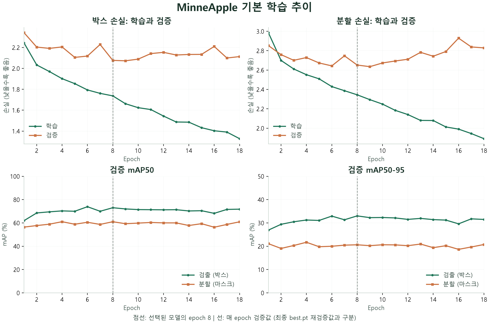
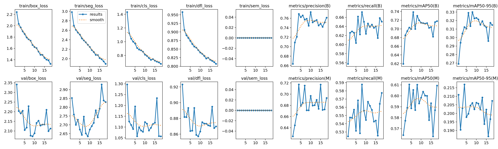
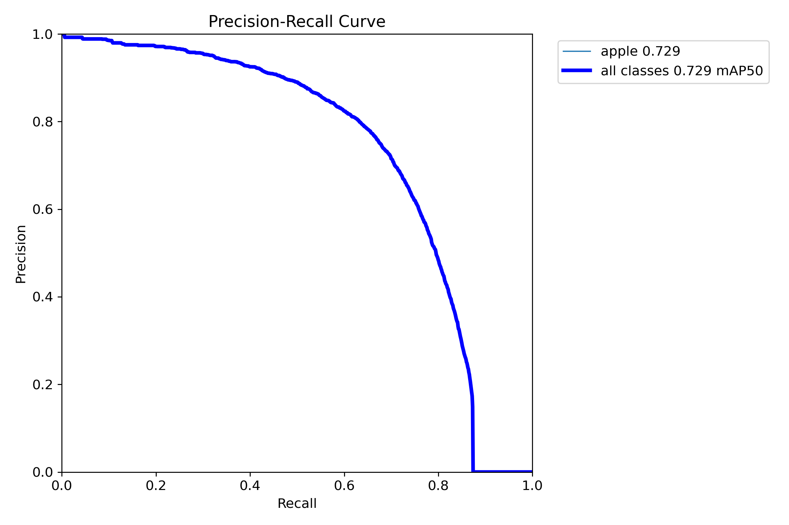
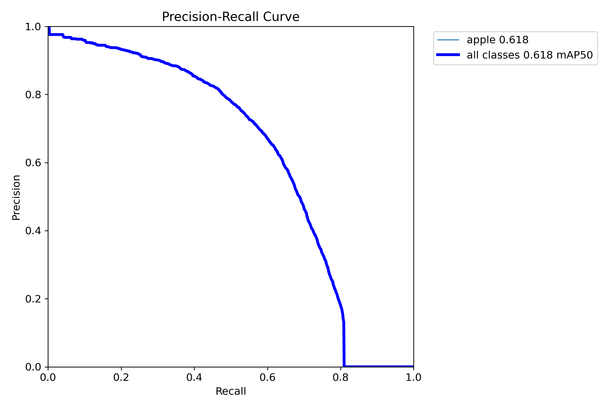

# MinneApple 기본 학습 결과 정리

작성일: 2026-11-16 (한국시간)  
실행: baseline_colab_20261116T134014519362Z

## 1. 종료 원인

이번 학습은 오류 없이 **18 epoch에서 조기 종료(EarlyStopping)**됐다.

- 최대 학습 횟수: 50 epoch
- 개선 대기 횟수: patience=10
- 검출·분할 종합 기준 최적 모델: 8 epoch
- 이후 10 epoch 동안 종합 기준 개선이 없어 종료
- 최종 상태: completed
- 학습 손실: 유한값 확인, NaN·무한값 없음

현재 저장된 완료 실행 출력에는 CUDA 메모리 부족, 예외로 인한 학습 중단, Drive 백업 실패가 확인되지 않는다. 실행 전에 있었던 연결 문제와 이번 완료 학습의 종료 원인은 구분한다.

## 2. 데이터와 실행 조건

| 항목 | 내용 |
|---|---|
| 모델 | COCO 사전학습 YOLOv8n-seg에서 새로 학습 |
| 학습 데이터 | 518장, 사과 주석 22,082개 |
| 검증 데이터 | 152장, 사과 주석 6,101개 |
| 총 데이터 | 670장, 사과 주석 28,183개 |
| 입력 / 배치 | imgsz=640 / batch=1 |
| 마스크 | mask_ratio=1 / overlap_mask=True |
| 최적화 | AdamW / lr0=0.001 / seed=42 / AMP 사용 |
| 실행 환경 | Tesla T4, VRAM 약 14.56GiB |
| 라이브러리 | Ultralytics 8.4.215 / PyTorch 2.14.1+cu130 / Python 3.13.16 |
| 시간 | 학습 루프 약 35분 10초; 검수·최종 검증·백업 포함 약 36분 47초 |
| 데이터 검사 | 손상 이미지 0개, 입력 마스크 검사상 빈 객체 마스크 0개 |

입력 마스크가 비어 있지 않다는 것은 모든 작은 사과가 반드시 검출되거나 학습의 양성 예측으로 배정된다는 의미는 아니다.

## 3. 선택된 best.pt 재검증 결과

아래 수치는 학습 종료 후 선택된 best.pt를 다시 검증한 값이다. 마지막 18 epoch 모델(last.pt)의 값이나 학습 중 8 epoch 행과 구분한다.

| 지표 | 검출 (박스) | 분할 (마스크) |
|---|---:|---:|
| Precision | 75.75% | 67.88% |
| Recall | 67.14% | 59.48% |
| mAP50 | 72.85% | 61.81% |
| mAP50-95 | 33.01% | 21.53% |

- Precision: 사과라고 예측한 결과 중 정답으로 인정된 비율.
- Recall: 정답 사과 중 찾아낸 비율.
- mAP50: IoU 0.50 기준의 평균 정밀도.
- mAP50-95: IoU 0.50부터 0.95까지 여러 기준에서 계산한 평균 정밀도. 단순 정확도와 다르다.
- 단일 클래스 apple에 대한 결과이며, 독립 시험 성능이 아닌 고정 검증 데이터에 대한 결과다.

검출보다 분할 지표가 낮다. 위치·경계 일치를 엄격하게 평가하면 성능이 크게 낮아져, 누락·오검출·마스크 경계를 실제 이미지로 확인할 필요가 있다. 지표만으로 개별 오류 원인을 확정하지 않는다.

## 4. 학습 추이

아래 표는 results.csv에 기록된 매 epoch 값이다.

| 항목 | 1 epoch | 8 epoch | 18 epoch |
|---|---:|---:|---:|
| 학습 박스 손실 | 2.24317 | 1.73692 | 1.32756 |
| 학습 분할 손실 | 2.98560 | 2.34459 | 1.89182 |
| 검증 분할 손실 | 2.85281 | 2.65182 | 2.82893 |
| 검출 mAP50 | 61.95% | 73.03% | 71.78% |
| 분할 mAP50 | 56.40% | 61.02% | 60.94% |
| 검출 mAP50-95 | 26.91% | 33.01% | 31.49% |
| 분할 mAP50-95 | 21.09% | 20.61% | 20.74% |

학습 손실은 감소하지만 검증 성능은 지속적으로 개선되지 않았다. 특히 분할 mAP50-95는 1 epoch 대비 18 epoch에서 개선되지 않았다. 추가 학습만으로 성능이 좋아진다고 판단할 수 없다.

원본 그래프의 sem_loss=0은 이 모델에서 별도 semantic loss가 활성화되지 않은 기록이며, 분할 학습 전체가 수행되지 않았다는 의미가 아니다.

## 5. Precision-Recall 그래프

두 PR 그래프는 최종 best.pt 검증에서 생성한 원본 그래프다. 최종 성능표와 같은 검증 단계의 자료이며, 학습 추이 그래프의 각 epoch 점과 구분한다.

## 6. 기록상 주의점

1. 종료 뒤 BASELINE_PROGRESS에 epoch=19가 한 번 표시된다. 최종 검증 때 같은 콜백이 호출된 표시 문제다. results.csv는 18행이고, 최종 epochs_completed도 18이다.
2. Mosaic·좌우반전·HSV 등 명시한 증강은 0으로 설정했지만, Colab 실행 로그에는 Albumentations의 Blur, MedianBlur, ToGray, CLAHE가 각각 p=0.01로 활성화된 구성이 남아 있다. 따라서 이번 실험을 완전한 무증강이라고 표현하면 안 된다. 개별 이미지에 실제 적용된 횟수는 이 로그만으로 확인할 수 없다.
3. best.pt는 검출·분할 종합 기준으로 선택됐다. 분할 지표 하나만 최고인 epoch라는 뜻은 아니다.
4. best.pt와 last.pt는 약 7MB로 저장됐다. 완료 후 optimizer 상태가 제거된 모델이므로 그대로 optimizer 상태까지 보존한 중간 체크포인트와는 다르다.
5. 새 이미지 추론에는 우선 best.pt를 사용하고, 독립 시험 이미지의 누락·오검출·가림 조건을 다음 단계에서 확인한다.

## 7. 발표·팀 활동 보고서용 문장

> MinneApple의 학습 이미지 518장과 검증 이미지 152장을 사용하여 YOLOv8n-seg 기본 모델을 학습하였다. 최대 50 epoch와 조기 종료 대기 횟수 10을 설정하였으며, 검출·분할 종합 기준으로 8 epoch의 모델을 선택하고 18 epoch에서 정상 조기 종료하였다. 선택 모델의 최종 검증 결과는 검출 mAP50 72.85%, 분할 mAP50 61.81%였으며, mAP50-95는 각각 33.01%, 21.53%였다. 이후 실제 예측 이미지를 통해 누락·오검출 및 분할 경계 오류를 분석할 예정이다.

실험 조건에는 Albumentations의 소확률 영상 증강이 포함되었다고 함께 명시한다.

## 8. 원본과 파일 활용

- [Colab 노트북](https://colab.research.google.com/drive/1O6Xe7dGmxlj9Xnjn1vtwCqqUbN5BlbOB)
- [Drive 결과 폴더](https://drive.google.com/drive/folders/1qwZv8nkWNvy6v2A31Eo7EHJkZryUYXrF)
- results.csv: Excel에서 열거나 추가 분석할 epoch별 수치
- baseline_summary.json: 완료 상태·최종 지표·체크포인트 SHA-256
- run.log: 조기 종료와 최종 검증 근거
- graphs/학습추이_요약.png: 발표용으로 다시 그린 핵심 그래프
- graphs/results.png: Ultralytics 원본 전체 학습 그래프
- graphs/BoxPR_curve.png, graphs/MaskPR_curve.png: 원본 PR 그래프

요약 그래프는 원본 CSV의 수치로 생성했으며, 원본 PNG는 수정하지 않았다.

